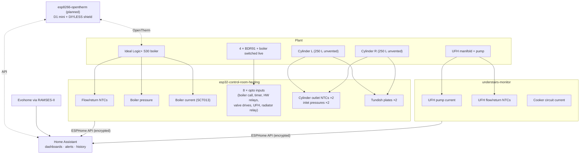

# Heating Plant Monitoring: Boiler, Cylinders and Safety Devices on ESPHome (WIP)

**Instrumenting a domestic heating plant the way a BMS instruments a plant room. Two ESP32-S3 boards running ESPHome monitor the boiler's flow/return temperatures, system pressure, electrical load and operating state; the boiler call, hot-water timer and cylinder stat signals alongside the Evohome relay states; both unvented hot-water cylinders (outlet temperatures, inlet pressures, tundish discharge); and the underfloor heating plant. A planned OpenTherm stage moves the boiler to modulating, PID-trimmed flow-temperature control, with Evohome as an input rather than the controller.**

> **The short version:** a plant-room points list built from scratch:
> - **temperatures** (NTC dividers)
> - **pressures** (0.5-4.5 V transducers through 10k/20k dividers)
> - **current** (SCT013 clamps with a bias network, banded into boiler states: Off, Idle, Pump, Ignition, Firing Low/High, Overrun, and a "firing without call" alarm)
> - **demand** (230 V opto-isolated boiler switched live, timer output, hot-water relays, valve drives, UFH and radiator relays)
> - **leak detection** (pulsed tundish plates)
>
> **Built so far:** both boards' firmware; boiler flow/return, system pressure (calibrated), current and banded states; both cylinders' outlet temperatures and inlet pressures (live, left/right verified), a per-cylinder "hot water available" estimate, and both tundish sensors (water-tested); the opto enclosure (logic side); an off-board rewiring of the control-room board ([full schematic](docs/12-control-room-wiring-schematic.md)); and a 23-rule alerts package ([doc 15](docs/15-alerts.md)).
>
> **In progress:** the boiler gauge box, the inlet span check (tyre gauge), the PRVs settling at ~2.5 bar, the opto board's mains side at the junction-box rewire, slow-leak diagnosis, and the legionella setpoint decision.
>
> **Then:** OpenTherm with a DIYLESS shield and PID logic.

**Portfolio position:** Stage 2.5 · Heating instrumentation and protocol integration. Feeds #4 optimum start, #5 energy, #6 alarms and #8 PID. Related: [Evohome controls & RAMSES-II](https://github.com/the-control-cabinet/evohome-heating-controls-ramses-integration) · [Mains water metering](https://github.com/the-control-cabinet/mains-water-metering-modbus-rtu) · [HA integration schedule](https://github.com/the-control-cabinet/home-assistant-integration-schedule)

---

## Status at a glance

| Area | Status |
|---|---|
| ESPHome firmware: control room + understairs | ✅ Both written and flashed |
| Control-room wiring | ✅ Off-board rework (gauge boxes, bus strip, posts, clamp strip): [schematic](docs/12-control-room-wiring-schematic.md) |
| Boiler pressure transducer | ✅ Calibrated to the gauge (3 points), filtered · ⏳ gauge box, move to GPIO6, re-check |
| Boiler flow/return NTCs | ✅ Installed, meter-checked (11 Nov) |
| Boiler current clamp | ✅ Fitted, ±3% vs meter, states retuned · bias fault (screen joined to white) found and fixed · ⏳ 3 turns |
| Opto board (8 inputs, own enclosure) | ✅ Enclosure and logic side ([schematic](docs/11-opto-board-installation.md#5-as-built-enclosure-schematic-and-status-10-nov-2026)) · ⏳ mains side at the rewire |
| Cylinder hot-outlet NTCs ×2 | ✅ Fitted, meter-checked, left/right verified · "hot water available" v3 with per-cylinder draw capture ([doc 14](docs/14-hot-water-stratification.md)) |
| Cylinder inlet pressures ×2 | ✅ Live, left/right verified, alerts on · ⏳ tyre-gauge span check |
| Expansion vessels | ✅ Replaced 11 Nov (24 L, 3.5 bar), peak 3.8 bar on reheat · ⏳ PRVs settle ~2.5 bar ([doc 05](docs/05-dhw-cylinders-expansion-and-tundish.md#plumber-visit-and-commissioning-11-nov-2026)) |
| Tundish sensors ×2 | ✅ Commissioned, water-tested (naming confirmed), no wet events with the new vessels |
| Alerts | ✅ 23-rule package live ([doc 15](docs/15-alerts.md)) |
| Understairs board: UFH pump + cooker clamps, UFH flow/return, (proposed) manifold pressure | ✅ Flashed · ⏳ sensors to connect |
| OpenTherm + PID | 📐 Designed in its own repo: [opentherm-boiler-control-esphome](https://github.com/the-control-cabinet/opentherm-boiler-control-esphome) · node hardware assembled |

Full tracker: [docs/08](docs/08-commissioning-tracker.md)

## Architecture

## Points list

| # | Point | Board / GPIO | Type | Range / scaling | Status |
|---|---|---|---|---|---|
| 1 | Boiler flow temperature | CR GPIO4 | AI | NTC 10k B3977 | ✅ Installed, meter-checked |
| 2 | Boiler return temperature | CR GPIO5 | AI | NTC 10k B3977 | ✅ Installed, meter-checked |
| 3 | Boiler ΔT | derived | Calc | Flow − return | ✅ Live |
| 4 | Boiler system pressure | CR GPIO6 | AI | 0-80 psi, 0.5-4.5 V, ÷0.667 (in the gauge box) | ✅ Calibrated · moving to GPIO6 |
| 5 | Boiler supply current | CR GPIO3 | AI | SCT013-015, 15 A/V | ✅ Live |
| 6 | Boiler electrical state | derived | Multi-state | Current bands + demand | ✅ Live (Overrun/Pre-Purge need IN1) |
| 7 | Firing without call | derived | Alarm | State vs demand | With #5 and #8 |
| 8 | Boiler call (switched-live joint) | CR GPIO14 | DI | Opto, 230 V | Logic side ✅ · mains at rewire |
| 9 | Hot water enabled (timer output) | CR GPIO18 | DI | Opto | Logic side ✅ · mains at rewire |
| 10 | HW relay L output (IN3) | CR GPIO15 | DI | Opto | To install |
| 11 | HW relay R output (IN4) | CR GPIO16 | DI | Opto | To install |
| 12 | IN5-IN8: cylinder valve drives, UFH relay, radiator relay (after bypass) | CR GPIO17 / 11 / 12 / 42 | DI | Opto | Logic side ✅ · mains at rewire |
| 13 | Cylinder L hot-outlet temperature | CR GPIO8 | AI | NTC | ✅ Live |
| 14 | Cylinder R hot-outlet temperature | CR GPIO9 | AI | NTC | ✅ Live |
| 15 | Cylinder L inlet pressure | CR GPIO2 | AI | 0-150 psi (10.34 bar) | ✅ Zeroed · span after plumber |
| 16 | Cylinder R inlet pressure | CR GPIO1 | AI | 0-150 psi | ✅ Zeroed · span after plumber |
| 17-18 | Tundish L / R wet + running | CR GPIO39 / 20 | DI | Pulsed plates, 2N7000 | ✅ Live |
| 19 | Tundish events | derived | Counter | Persistent | ✅ Live |
| 20 | UFH pump current / running | US GPIO10 | AI + derived | SCT013-005 (> 0.10 A = running) | Firmware ✅, clamp to fit |
| 21-22 | UFH flow / return (mixed side) + ΔT | US GPIO4 / 5 | AI | NTC | Firmware ✅, placement to decide |
| 23 | Cooker circuit current / on | US GPIO2 | AI + derived | SCT013-030 (> 1.0 A = on) | Firmware ✅, clamp to fit |
| 24 | UFH manifold pressure | US GPIO1* | AI | 0-5 bar | 📐 Proposed (leak isolation) |
| 25 | UFH zone heat demand ×6 | via RAMSES-II | Network | From the HCC80R | ✅ Live (Evohome repo) |
| 26 | Board health (online, Wi-Fi, uptime) | both | Diagnostic | | Live |
| 27-28 | Hot water available L / R | derived | Calc | Top + bottom temperatures ([doc 14](docs/14-hot-water-stratification.md)) | ✅ Live |

As built 11 Nov 2026: [doc 12](docs/12-control-room-wiring-schematic.md). CSV: [data/io-schedule.csv](data/io-schedule.csv)

## Key design points

- **Signal conditioning ([docs/02](docs/02-signal-conditioning-and-noise.md)):**
  - NTC dividers from 3V3
  - **10k/20k dividers** bring the 5 V sensors down to ≤3.0 V at the ADC
  - SCT013 clamps on a **1.65 V bias** with a 10 µF coupling capacitor, so both half-cycles stay in range
  - **ADC1 only** for analogue signals, since ADC2 is unusable with Wi-Fi on
- **NTC noise fix:** 100 nF at each ADC pin, twisted/shielded leads away from mains, `samples: 16` + median + moving average, decoupled 3V3, and probes lagged in.
- **Boiler current ([docs/03](docs/03-boiler-current-and-states.md)):** clamp on the **permanent live**, with 3-5 turns for resolution. States are banded from current plus the demand input. Thresholds are set from a week of real data.
- **Slow leak ([docs/04](docs/04-pressure-and-leak-diagnosis.md)):** compare pressure at the same cold condition daily, compute the decay rate, then isolate circuits one at a time. The PRV discharge, auto air vents and joints are checked; the boiler's expansion vessel is already ruled out.
- **Cylinders and tundishes ([docs/05](docs/05-dhw-cylinders-expansion-and-tundish.md)):** the inlet pressure rise during reheat reveals expansion-vessel health. Tundish plates are pulsed (150 ms every 5 s) to limit electrolysis, debounced, and counted.
- **Demand monitoring ([docs/06](docs/06-demand-monitoring-opto.md), [docs/11](docs/11-opto-board-installation.md)):** 230 V opto-isolation of the boiler switched live, the timer output and both cylinders' stat-passing points; relay states come from RAMSES-II.
- **Understairs UFH plant ([docs/10](docs/10-understairs-ufh-and-circuits.md)):** the UFH pump and cooker clamps at the consumer unit, mixed-side flow/return ΔT, HCC80R zone demand via RAMSES-II, and a proposed manifold pressure sensor for split-system leak testing. The firmware is flashed, and a no-sensors-attached test showed floating inputs producing plausible values, a useful lesson.
- **OpenTherm plan ([docs/07](docs/07-opentherm-and-pid-plan.md)):**
  - DIYLESS shield as the OpenTherm master, on its **own ESP8266 D1 mini node** (control kept separate from monitoring)
  - weather compensation + RAMSES-II demand trim + PID with anti-windup and minimum on/off times
  - DHW priority
  - an **interlocked relay changeover** back to Evohome control (force-guided contacts)

## Configuration files

| File | Content |
|---|---|
| [`config/esphome/esp32-control-room-heating.yaml`](config/esphome/esp32-control-room-heating.yaml) | Current control-room firmware: NTCs, pressure, clamp + state machine, opto inputs, tundishes |
| [`config/esphome/esp32-control-room-heating-proposed.yaml`](config/esphome/esp32-control-room-heating-proposed.yaml) | Proposed: 10k/20k dividers, noise filters, cylinder NTCs and pressures, opto pin moves |
| [`config/esphome/understairs-monitor.yaml`](config/esphome/understairs-monitor.yaml) | UFH pump and cooker clamps, UFH manifold NTCs |
| [`config/homeassistant/packages/heating_plant_alerts.yaml`](config/homeassistant/packages/heating_plant_alerts.yaml) | Alerts package: 23 automations, commissioning gates, derived sensors ([doc 15](docs/15-alerts.md)) |
| [`config/homeassistant/packages/dhw_hot_water_available.yaml`](config/homeassistant/packages/dhw_hot_water_available.yaml) | Hot water available v3: per-cylinder draw capture, cold-feed helper ([doc 14](docs/14-hot-water-stratification.md)) |
| [`config/homeassistant/dashboards/`](config/homeassistant/dashboards/) | Boiler plant card (with the cylinders) and hot water card |
| [`config/homeassistant/pressure-statistics.example.yaml`](config/homeassistant/pressure-statistics.example.yaml) | Noise floor (1 h std dev), mean, 7-day change |

All credentials are `!secret` references.

## Documents

| Doc | Covers |
|---|---|
| [01 Hardware and I/O schedule](docs/01-hardware-and-io-schedule.md) | Boards, pin rules, current vs proposed allocation, sensors |
| [02 Signal conditioning and noise](docs/02-signal-conditioning-and-noise.md) | Circuits, NTC noise fixes, calibration |
| [03 Boiler current and states](docs/03-boiler-current-and-states.md) | Clamp placement, turns, state banding, commissioning |
| [04 Pressure and leak diagnosis](docs/04-pressure-and-leak-diagnosis.md) | In-place zero/span (no draining), baseline stats, noise, leak-finding plan |
| [05 DHW cylinders, expansion and tundish](docs/05-dhw-cylinders-expansion-and-tundish.md) | Outlet temperatures, inlet pressures, plumber work, tundish sensors |
| [06 Demand monitoring (opto)](docs/06-demand-monitoring-opto.md) | BDR91 and switched-live inputs |
| [07 OpenTherm and PID: summary](docs/07-opentherm-and-pid-plan.md) | Summary, roadmap and link to the control repo |
| [08 Commissioning tracker](docs/08-commissioning-tracker.md) | Item-by-item status |
| [09 Safety](docs/09-safety.md) | Mains, gas, unvented cylinders, pressure fittings |
| [11 Opto board installation](docs/11-opto-board-installation.md) | Tap points from the junction box survey, enclosure, wiring, commissioning tests |
| [12 Control-room wiring schematic](docs/12-control-room-wiring-schematic.md) | Full as-built drawing, pin table, power-up checks |
| [13 Off-board wiring](docs/13-off-board-wiring.md) | Gauge boxes, bus strip, posts, clamp strip and the screen fault |
| [14 Stratification and hot water available](docs/14-hot-water-stratification.md) | Top/bottom temperatures, estimate v3 (per-cylinder draw capture), probe position, Centre Store settings |
| [15 Alerts](docs/15-alerts.md) | The alerts package: switches, 23 alerts, FDD mapping, commissioning lessons |
| [10 Understairs: UFH plant and circuits](docs/10-understairs-ufh-and-circuits.md) | UFH pump and cooker clamps, UFH temperatures and placement, HCC80R data via RAMSES-II, manifold pressure for leak isolation, floating-input lesson |

## Skills demonstrated

| Skill | Evidence |
|---|---|
| Plant-room points list | 26 points across AI, DI, derived, network and alarm types |
| Analogue signal conditioning | NTC dividers, 5 V→3.3 V dividers, CT bias and coupling, filtering |
| Current-based plant state detection | Boiler state machine from load current + demand |
| Pressure diagnostics | Leak decay-rate method; expansion-vessel health from inlet pressure |
| Life-safety-adjacent monitoring | Tundish discharge detection; unvented-cylinder safety checks |
| Isolation and segregation | 230 V opto inputs; mains vs low-voltage separation |
| Controls design | OpenTherm master with PID, weather compensation, fail-safe interlock |

📺 [The Control Cabinet on YouTube](https://www.youtube.com/channel/UC5Cupmz7vlfcodpCX7k8iuQ)

*Built and documented by James · part of [The Control Cabinet BMS portfolio](https://github.com/the-control-cabinet). MIT Licence.*
