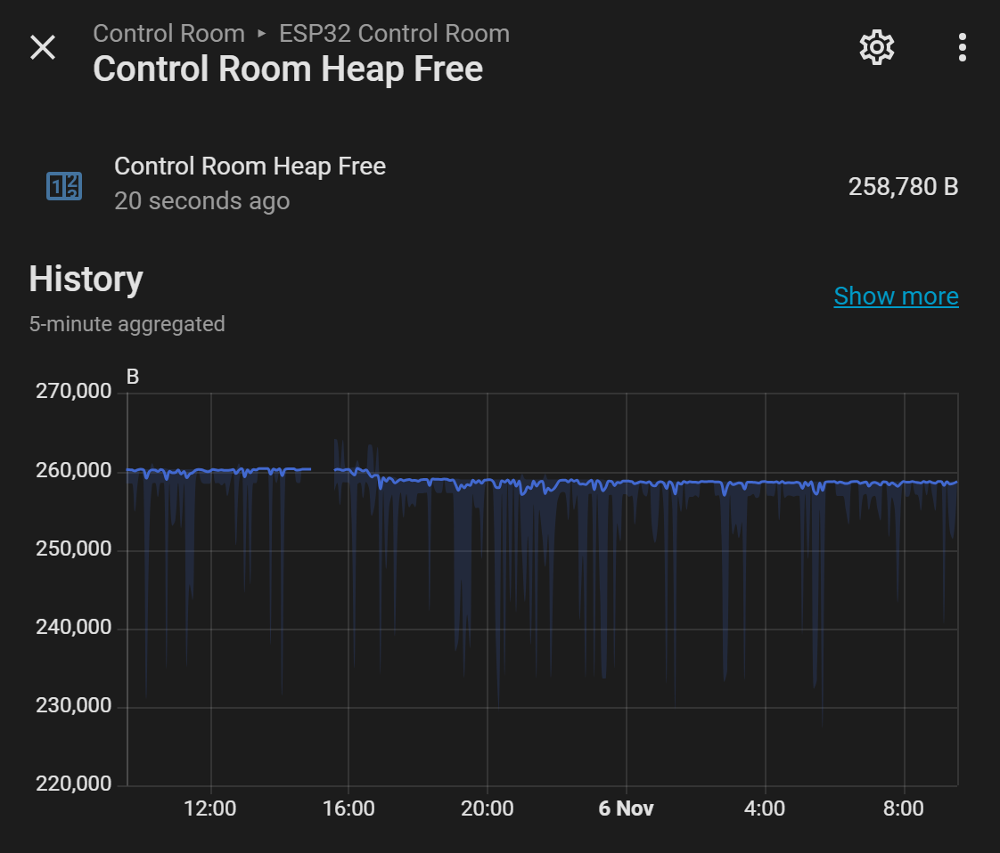

# 01 · Hardware and I/O Schedule

[← Back to README](../README.md) · Data: [`data/io-schedule.csv`](../data/io-schedule.csv)

## Boards

| Board | ESPHome name | Location | Role |
|---|---|---|---|
| ESP32-S3-DevKitC-1 (16 MB) | `esp32-control-room-heating` | Boiler / control room | Boiler temperatures, pressure, current, demand signals, tundishes, DHW cylinders |
| ESP32-S3-DevKitC-1 (16 MB) | `understairs-monitor` | Understairs (UFH manifold, consumer unit) | UFH pump and cooker circuit current, UFH manifold flow/return |
| diymore ESP8266 D1 mini + DIYLESS Master OpenTherm Shield (planned) | `esp8266-opentherm` | By the boiler, 3D-printed enclosure | OpenTherm master (control stage), kept separate from the monitoring board |

Both use encrypted API keys and credentials from `secrets.yaml`, MQTT keepalive 60 s, and OTA.

## Pins to avoid on the ESP32-S3 (board-wide)

| Pins | Reason |
|---|---|
| GPIO35, 36, 37 | Octal PSRAM |
| GPIO48 | On-board RGB LED |
| GPIO0, 45, 46 | Strapping pins |
| GPIO43, 44 | UART console |
| **ADC2 (GPIO11-20) for analogue** | ADC2 is unusable while Wi-Fi is on. Those pins are fine for **digital** use |
| **ADC1 = GPIO1-10** | The only ADC pins usable with Wi-Fi, so they're the scarce resource on this board |

## Control room: allocation (as built, 6 Nov 2026)

| Signal | GPIO | Type | Status |
|---|---|---|---|
| Boiler system pressure | **GPIO1** (signal joint on post IO2, to move off-board) | ADC1 | ✅ Installed, calibrated to the gauge, filtered |
| Cylinder left inlet pressure | **GPIO2** (once the IO2 post moves to a Wago) | ADC1 | With the plumber |
| Boiler supply current (SCT013-015) | GPIO3 (capacitor on post IO13) | ADC1 | To fit on the boiler's permanent live |
| Boiler return temp (NTC) | GPIO4 | ADC1 | ✅ Installed (3.3 kΩ) |
| Boiler flow temp (NTC) | GPIO5 | ADC1 | ✅ Installed (3.3 kΩ) |
| Opto: boiler demand / radiator demand | GPIO6 / GPIO7 | Digital | To install (can move to spare digital pins if an ADC pin is needed) |
| Cylinder left hot-outlet temp | GPIO8 | ADC1 | ✅ Installed |
| Cylinder right hot-outlet temp | GPIO9 | ADC1 | Wired; probe to strap on |
| Cylinder right inlet pressure | **GPIO10** | ADC1 | With the plumber |
| Opto: UFH / cylinder L / cylinder R | GPIO15 / 16 / 17 | Digital | To install |
| Tundish right sense (MOSFET 1 drain) | GPIO39 | Digital in | ✅ Commissioned |
| Tundish left sense (MOSFET 2 drain) | GPIO20 | Digital in | ✅ Commissioned |
| Tundish plate power (pulsed) | GPIO21 | Digital out | ✅ Commissioned |
| Tundish gate posts | IO38 (right), IO47 (left) | Posts (inputs only, internal pull-down switched by firmware) | ✅ |
| Tundish MOSFET 1 posts | IO40 (gate), IO41 (source → GND) | Posts | ✅ |

**Posts:** unconfigured GPIO terminals used as wiring junctions (IO2, IO13, IO38, IO40, IO41, IO47). They must stay out of the YAML (IO38/IO47 are set only as inputs by the tundish firmware). IO2 is being freed for the left inlet sensor.

**ADC1 budget:** with the two inlet sensors, all eight usable ADC1 pins (GPIO1, 2, 3, 4, 5, 8, 9, 10) are in use. Spare digital pins for the remaining opto inputs (IN6-IN8): GPIO11, 12, 14, 18, 42. Avoid GPIO19 (USB D-; GPIO20 is USB D+, so use only the UART port), 0/45/46, 35-37 and 48.

**Each inlet pressure sensor:** one GPIO; signal → Wago joint → 10 kΩ → GPIO; 20 kΩ and 100 nF GPIO → GND; 10 µF + 100 nF across its 5 V/GND at the sensor. 5 V and GND distributed to all three pressure sensors from one Wago each. 0-150 psi (0-10.3 bar), 0.5-4.5 V: at most 3.0 V at the pin; ~1.1 V at 3 bar.

**Board health after the changes:** heap flat at ~259 kB overnight (no leak), loop time 3-5 ms.

## Understairs board (firmware flashed, sensors to connect)

| Signal | GPIO | Sensor |
|---|---|---|
| Cooker circuit current | GPIO2 | SCT013-030 (30 A = 1 V) |
| UFH pump current | GPIO10 (anchor GPIO12) | SCT013-005 (5 A = 1 V) |
| UFH flow temp (mixed) | GPIO4 | NTC 10k B3977 |
| UFH return temp | GPIO5 | NTC 10k B3977 |
| UFH manifold pressure (proposed) | GPIO1 | 0-5 bar transducer, 10k/20k divider |

Full detail: [doc 10](10-understairs-ufh-and-circuits.md)

## Sensors used

| Sensor | Range / output | Supply |
|---|---|---|
| NTC strap-on probes | 10 kΩ at 25 °C, **B = 3977** (corrected from the generic 3950) | Divider from 3V3 |
| Boiler pressure transducer | 0-5 bar, G1/4, 0.5-4.5 V | 5 V |
| Cylinder inlet transducers | 0-150 psi (0-10.34 bar), 0.5-4.5 V | 5 V |
| SCT013 current clamps | 015 = 15 A/1 V; 030 = 30 A/1 V; 005 = 5 A/1 V; built-in burden | Bias network |
| Opto-isolator module | Hailege 8-ch AC 220 V optocoupler; 230 V input → isolated logic output | **3.3 V logic supply** (outputs pulled up to VCC) |
| Tundish leak plates | Gold-plated contact plates + 2N7000 MOSFET | Pulsed 3V3 |
