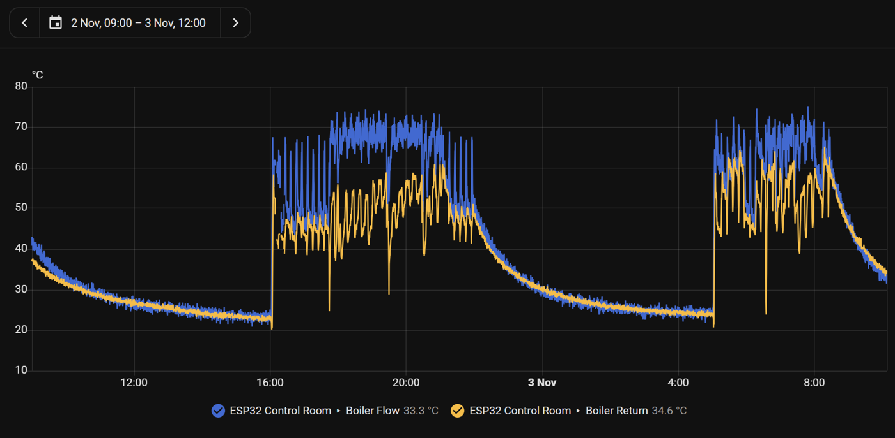
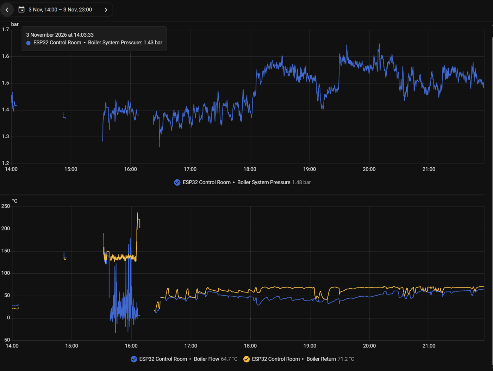

# 02 · Signal Conditioning and Noise

[← Back to README](../README.md)

## Circuits

**NTC (temperature)**
```
3V3 ── 3.3k ──┬── GPIO (ADC1)
              ├── 100 nF ── GND        (leaded caps to fit)
              └── NTC ── GND
```
ESPHome converts the voltage to resistance (`resistance`, DOWNSTREAM, 3.3 kΩ), then to temperature (`ntc`, B = 3977, 10 kΩ at 25 °C). **3.3 kΩ, not 10 kΩ:** a 10k NTC is about 1.8 kΩ at 70 °C, so a 3.3 kΩ top resistor puts boiler temperatures (~1.1 V at 70 °C) in the ADC's most linear range.

**5 V sensor (pressure) → 3.3 V ADC: new 10k/20k divider**
```
Sensor out ── 10k ──┬── GPIO (ADC1)       Vadc = Vsensor × 20/30 = 0.667
                    └── 20k ── GND        4.5 V max → 3.0 V at the pin
```
It replaces the three-resistor chain (10k + 10k + 10k, with an anchor pin and a bridge pin). The ratio is identical, there are fewer joints, and two GPIOs are freed.

**Current clamp (SCT013): bias and coupling**
```
3V3 ── 10k ──┬── 10k ── GND      (1.65 V mid-rail bias)
             ├── GPIO3 (ADC1)
             └── 10 µF ── clamp tip      (clamp sleeve → GND)
```
The clamp's AC output rides on the 1.65 V bias, so both half-cycles stay inside the ADC range. An earlier design without the bias network would have clipped the negative half-cycle; this was caught and fixed in design.

## The flow/return noise was a wrong resistor (fixed 3 Nov 2026)

The flow and return readings were noisy and jumpy from installation. A **powered voltage test** at the ADC pins found the cause: the top resistors fitted were **330 kΩ, not 3.3 kΩ** (a colour-band misread). With 330 kΩ against a ~2 kΩ NTC, the pin sat at a few tens of mV, at the bottom of the ADC's range, where its own noise and non-linearity dominate. Fitting 3.3 kΩ (twin-entry ferrules with the NTC leads in IO4/IO5) gave clean readings immediately. The two inputs were also found swapped during the rework and corrected in YAML (flow = GPIO5, return = GPIO4).





**Standing-offset check (5 Nov, 03:30-06:30, boiler off):** the return read 0.52 → 0.25 °C above the flow, **shrinking** through the period, so part of it was the pipes still settling, not sensor offset. No offset is applied yet; recheck after a longer standing period. The true offset is at most ~0.25 °C, inside a 1% NTC's tolerance.

## Other NTC noise causes and fixes

| Likely cause | Fix | Priority |
|---|---|---|
| No filter capacitor at the ADC pin | **100 nF ceramic** from each NTC ADC pin to GND, at the ESP end | 1 |
| Leads near mains and boiler wiring | The probes are **strap-on types with their own short moulded leads** (probably unshielded). With short runs, the capacitor and filters should be enough. Route them away from 230 V and don't bundle them with mains; use shielded extension only if noise persists | 2 |
| Single-shot ADC readings | ESPHome `samples: 16` (averages 16 conversions), then `median` (kills spikes), then `sliding_window_moving_average` | 1 |
| 3V3 rail noise (Wi-Fi bursts) | A divider fed from 3V3 tracks rail noise. Add 10 µF + 100 nF on the 3V3 feed to the dividers; keep it separate from relay or opto supplies | 2 |
| ESP32 ADC non-linearity at 12 dB | Calibrate at operating temperatures (below); the middle of the range is most linear | 2 |
| Poor thermal contact | Thermal paste, a tight strap, and **lag over the probe**, so it reads the pipe and not the air | 2 |

**Expected result:** a steady reading to about ±0.2 °C at a stable temperature, and a clean flow-minus-return ΔT.

## Calibration

| Signal | Method |
|---|---|
| NTCs | Two-point check against a reference thermometer (cold, e.g. a water bath, and hot, a running flow pipe). Apply `offset`, or `calibrate_linear` if both ends differ |
| Pressure transducers | **Zero:** read the output at 0 bar gauge (open to air before fitting, or isolate and vent) and set the `*_zero_v` substitution. **Span:** compare with a known reference (the mechanical gauge) at working pressure |
| Current clamp | Zero with no load; then a known resistive load (e.g. a kettle, ~9-13 A, or a lower load with several turns through the clamp), measured with a clamp meter → `calibrate_linear` |
