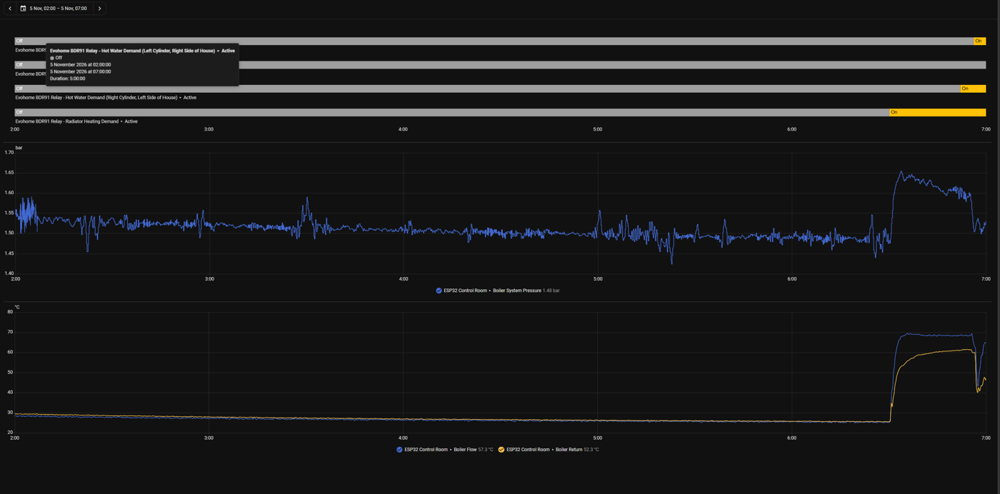
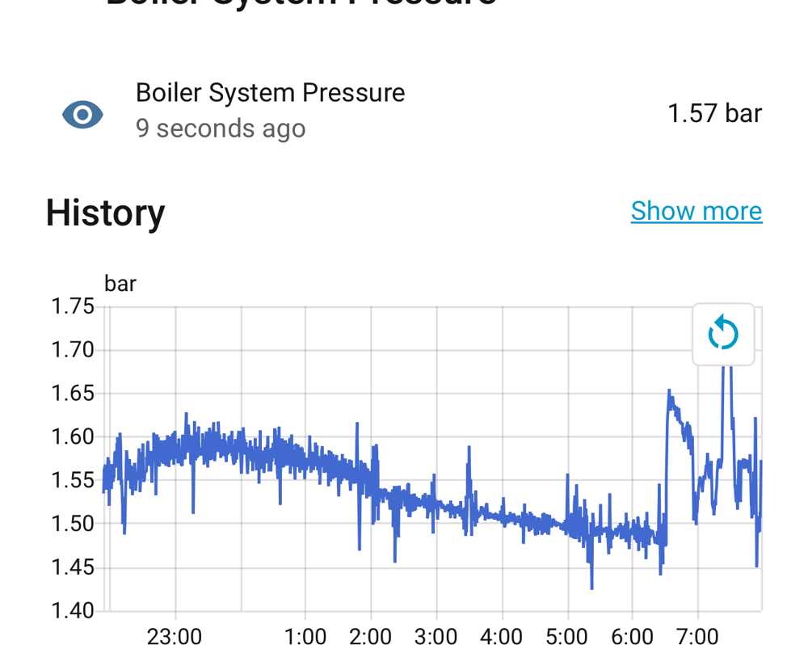
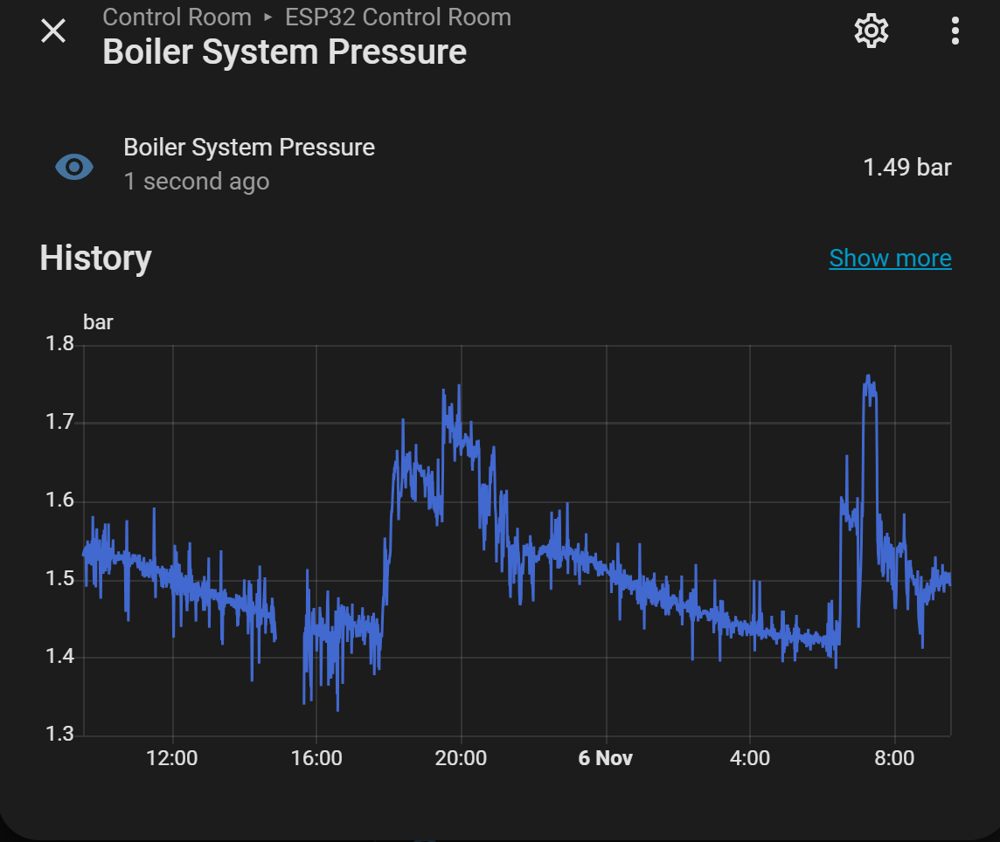

# 04 · Boiler Pressure and Slow-Leak Diagnosis

[← Back to README](../README.md)

## Sensor status
- 0-80 psi (0-5.5 bar) transducer (0.5-4.5 V, G1/4, 5 V ratiometric) **installed** on the primary circuit; 10k/20k divider (measured ratio 0.664) to GPIO1, 100 nF at the pin.
- **Calibrated to the boiler gauge** (3 points, 3-4 Nov 2026) and **filtered** (5 Nov). Next: the zero at the next drain-down, a test gauge, the 10 µF supply capacitor, then leak diagnosis.

## Calibration done (3-4 Nov 2026)

**ADC first:** a two-point calibration of the pin voltage against a meter (16 samples, 100 nF fitted). Rechecked hot: HA 0.972 V = meter 0.972 V.

**Then pressure against the boiler's gauge:**

| Gauge | HA (before) | Difference |
|---|---|---|
| 1.10 bar (cold) | 1.00 bar | 0.10 |
| 1.60 bar (cold, after a top-up) | 1.42 bar | 0.18 |
| 1.65 bar (hot) | 1.46 bar | 0.19 |

A **straight line**: the first two points predicted 1.648 bar for the third. Best fit: gauge = 1.193 × HA − 0.093, all points within 0.002 bar, applied as a least-squares `calibrate_linear`. **Valid range checked: 1.0-1.65 bar only** (the zero waits for a drain-down; the gauge itself is unverified).

## Zero and span calibration (no draining needed)

Venting the sensor to 0 bar would mean draining down again, so calibration uses readings in place.

**Why the zero matters less than it seems:** leak diagnosis uses **changes** in pressure (bar/day). A fixed zero offset cancels out of every difference, so the decay rate is unaffected by it.

**1. Single-point offset against the mechanical gauge**

The sensor's slope is fixed by its specification: 0.5-4.5 V over 0-5 bar = **0.8 V/bar** at the sensor (0.533 V/bar at the ADC after the 2/3 divider). One reference reading is enough to fix the zero:
1. Choose a **stable, cold** moment (heating off, e.g. early morning).
2. Note the boiler's **mechanical gauge** reading, *P_gauge*.
3. Take the **median sensor voltage** over that minute (ADC voltage ÷ 0.667), *V*.
4. `boiler_p_zero_v = V − 0.8 × P_gauge`. *Example:* V = 1.43 V at 1.2 bar → 1.43 − 0.96 = **0.47 V**.

**2. Span check at the next top-up**

Record both the sensor and the gauge **before and after** a filling-loop top-up. The sensor's change should match the gauge's (e.g. +0.5 bar ≈ +0.40 V at the sensor). If it doesn't, the two before/after pairs give a two-point calibration (`calibrate_linear`).

**3. Baseline statistics**

Log the filtered pressure (and raw voltage) with a statistics sensor ([example](../config/homeassistant/pressure-statistics.example.yaml)) over an hour at steady conditions. The **standard deviation** is the real noise floor. Use it to confirm the noise fixes, and to set alert margins above it.

**Accuracy statement:** absolute pressure is "good to the mechanical gauge" (about ±0.1 bar). The **decay rate** used to find the leak is much more precise, because it's a difference.

**Supply check:** these sensors are ratiometric to their **5 V supply**. Measure the 5 V at the sensor; if it's low or noisy, the reading shifts. Use a clean, decoupled 5 V.

## Noise (5-6 Nov 2026)

**Two kinds of variation, only one of them noise:** with the heating running, swings of 0.05-0.2 bar follow the heating cycles (real expansion). Overnight, with everything off, there was **±0.02 bar fuzz** and occasional single dips of 0.05-0.1 bar.

**Where it comes from:** the noise arrives in **bursts** (e.g. 02:00, 03:30, 05:00-05:35) while the flow/return NTCs, on the same ADC, stay smooth, and with all relays off and flow/return flat (no pump runs). So it isn't the ADC and it isn't real pressure: it enters through the sensor's own path, most likely **ripple on its 5 V supply** (the unregulated USB 5 V, passed straight through to a ratiometric sensor), from something switching elsewhere at night.

**Filtering:** a fast path and a slow path, because noise that varies over seconds can only be averaged out over time:
- **Boiler System Pressure (fast)**, diagnostic: 1 s readings, 7-reading sliding median (removes single-sample glitches), 5-reading average: responds in ~5-8 s, for pump and valve events.
- **Boiler System Pressure**, main: a 1-minute average of the fast one, published every 10 s, for dashboards and alerts. (The `copy` platform inherits the source's diagnostic category; `entity_category: ""` keeps it in the main list.)

A first attempt with oversampling and short windows gave **no visible improvement**, which is what led to the two-path design. Result: the overnight line roughly **three times tighter**.

**Still to do, one change at a time:** 10 µF (+100 nF) across the sensor's 5 V and GND at the sensor end; then, if needed, 1 µF instead of 100 nF at GPIO1; then a better USB supply for the ESP32.

## Slow-leak diagnosis plan

**What's known:** the system loses pressure slowly, **about 1.5 bar → 1.0 bar over roughly two weeks**, which is about **0.25 bar/week (≈0.035 bar/day)**. That's slow enough to point to a small weep rather than a burst, and fast enough to need finding. The **boiler's own expansion vessel was recharged and its diaphragm isn't leaking**, so the loss is elsewhere.

**Step 1: measure it properly**
- Pressure varies with water temperature (expansion), so compare readings **at the same condition**: e.g. **05:00 daily, heating off, system cold**.
- Record the **bar/day decay rate** over 5-7 days (the template example in `config/homeassistant/`).
- Plot pressure against flow temperature to separate thermal swings from real loss.

**Step 2: find it**

| Check | How | What it tells you |
|---|---|---|
| Boiler pressure relief valve discharge | Check the PRV discharge pipe outlet (outside) for drips or staining | A passing PRV loses water silently |
| Auto air vents | Pump/boiler AAV and any manifold vents: look for damp or crusting | Vents can weep |
| Visible joints, valves | Radiator valves, TRV bodies, manifold, cylinder primary connections, under floors where accessible | Tide marks or corrosion |
| **Circuit isolation** | Isolate one circuit at a time (radiator flow/return, UFH manifold, each cylinder primary) for 24-48 h, cold, and compare decay rates | The circuit whose isolation stops the decay holds the leak |
| Cylinder coil | A leaking coil normally **raises** primary pressure (mains pressure pushes in), so a falling pressure points away from the coils | Rules a fault in or out |

**Step 3: alarm**
- Low pressure (< 1.0 bar for 10 min) and abnormal 24 h decay go to phone alerts.
- **Baseline decay** ≈ 0.035 bar/day. After a fix, success means the cold-condition reading holding steady for 2+ weeks.

## Dashboard
Pressure with 7-day history, the daily 05:00 reading, decay rate, and the boiler flow temperature overlaid.
