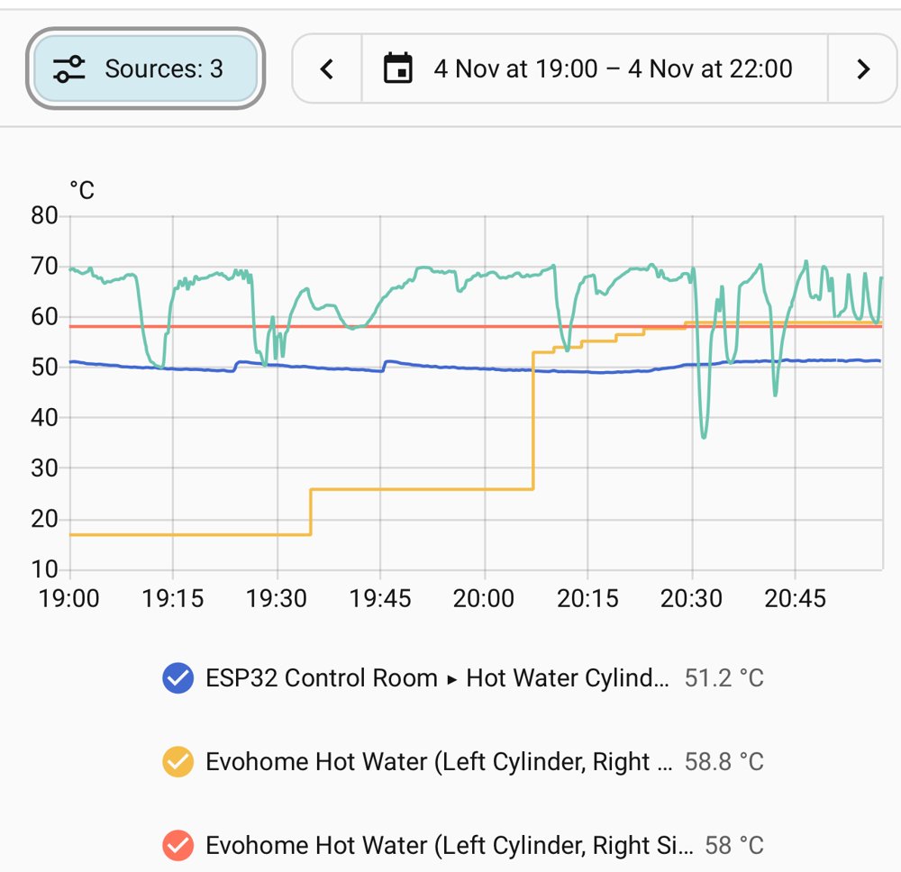
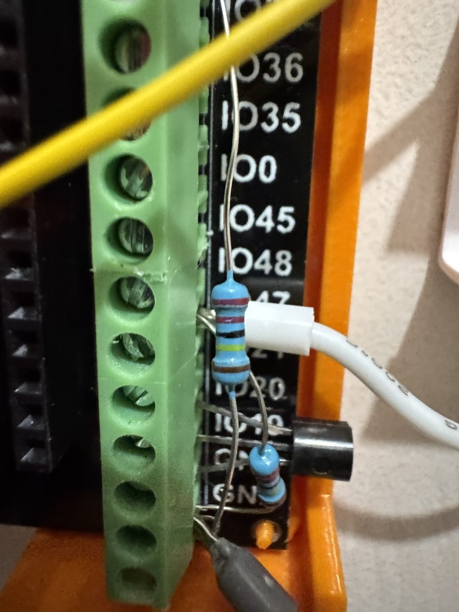
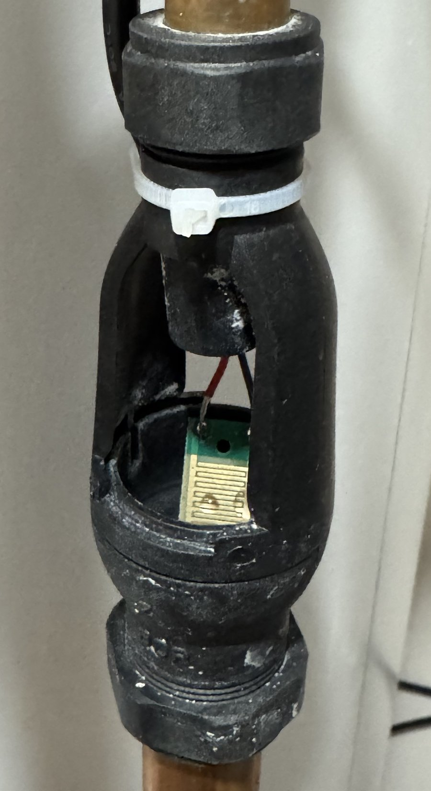
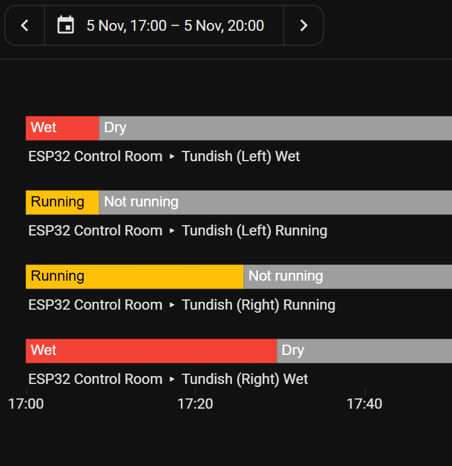

# 05 · Hot-Water Cylinders: Outlet Temperatures, Inlet Pressures, Expansion and Tundishes

[← Back to README](../README.md)

Two 250 L unvented indirect cylinders, each heated by the boiler through a BDR91-switched zone valve (see the [Evohome repo](https://github.com/the-control-cabinet/evohome-heating-controls-ramses-integration)).

## Hot-outlet temperatures (left installed 4 Nov 2026; right wired, probe to fit)
- One 10k B3977 strap-on NTC on each cylinder's **hot outlet pipe**, near the cylinder, with paste, a strap and **lagging over the probe**; 3.3 kΩ dividers on GPIO8 (left) and GPIO9 (right).
- Uses: delivered hot-water temperature, reheat confirmation, a **Legionella check** (weekly peak ≥ 60 °C), and comparison with the Evohome cylinder probe.
- The same noise fixes and calibration as the boiler NTCs ([02](02-signal-conditioning-and-noise.md)).

### First reheat seen (left cylinder, 4 Nov 2026)

| Time | Lower part (Evohome CS92) | Top (outlet NTC) |
|---|---|---|
| 19:00 | **17 °C** (heavy use: stratified) | 51 °C |
| 19:29 | relay on | |
| 20:07 | 53 °C | 49 °C |
| 20:29 | **58 °C** (setpoint) | 51 °C |

About an hour from 17 to 58 °C: roughly **12 kWh into 250 L, so ~12 kW** through the coil while the boiler also heated the other cylinder, the UFH and radiators. That's the baseline for the planned lower flow temperature. The outlet reads a few degrees below the water (a pipe sensor), and its small regular bumps follow the **boiler's cycling** (heat picked up from nearby primary pipework), not hot-water draws.

## Cold-inlet pressure (to install with the plumber)
- **Ausla 0-150 psi** stainless transducers (G1/4, 5 V supply, 0.5-4.5 V out), one on each cylinder's cold inlet **after the pressure-reducing valve**, fitted while the plumber is on site.
- **What they show:**
  - **Static pressure** = the PRV set point (typically 3 bar).
  - **During reheat, the pressure rises** as the water expands. With a healthy expansion vessel the rise is small.
  - **A steep rise toward the expansion relief valve setting (6 bar here)** means a **failed or flat expansion vessel**, and the tundish will discharge.
  - **Alert thresholds:** warning at **5.0 bar**, critical at **5.5 bar**.
  - **A drop during draws** shows the supply and PRV performance.

## Plumber work (planned, one visit)

| Item | Why |
|---|---|
| Replace both cylinders' **expansion vessels** | Ageing vessels; prevents expansion discharge |
| Replace the **expansion relief / pressure-reducing valves** as needed | Same visit; restores the safety set |
| Fit the two **inlet pressure gauge points** (transducer tees) | Instrumentation at the same time |
| Verify the **high-limit cut-out wiring** (in series with each zone valve) | ⚠️ Open safety check from the Evohome install |

## Tundish drip sensors (commissioned 5 Nov 2026)

**Design:**
- Gold-plated contact plates in each tundish's discharge path.
- **Plate power is pulsed:** GPIO21 switches 3V3 to both plates for **150 ms every 5 s**. Pulsing minimises electrolysis and plate corrosion.
- Water bridging a plate turns on its **2N7000 MOSFET**, which pulls the sense pin low (GPIO39, GPIO20; pull-up, inverted).
- **Debounce:** wet only after **2 consecutive** wet samples. Each dry → wet transition increments a **persistent event counter**.
- **In HA:** Tundish (Left/Right) Wet, Tundish Any Wet, the event counts, and a reset button; plus **Running** sensors (below).

**As built:** 2N7000 per plate; gate pull-down **2.2 MΩ** (red-red-black-yellow-brown, ~2.16 MΩ measured in place); the plate's B core lands on a **junction post** (an unconfigured GPIO terminal) with the gate link and pull-down; plate A cores share GPIO21 in a twin ferrule. 3-core screened cable: screen to GND at the ESP32 end only, spare core insulated. Plates must touch only through water, never metal.

| Tundish | Gate post | MOSFET | Sense |
|---|---|---|---|
| Left | IO47 | 2 (S → GND) | GPIO20 |
| Right | IO38 (linked to IO40) | 1 (S → IO41 → GND, G → IO40) | GPIO39 |

**Why 2.2 MΩ:** the water and the pull-down form a divider on the gate; the higher the pull-down, the less water it takes to lift the gate past the 2N7000's ~2-3 V threshold (a 200 kΩ film gives ~3.0 V with 2.2 MΩ, ~2.75 V with 1 MΩ). Much higher and condensation or leakage could trigger it.

**Commissioning faults found and fixed:**
1. **Both sensors flickered wet/dry while dry:** a missing GND connection left the circuit floating. Stable once connected.
2. **Left and right were swapped:** the cables had landed on the opposite circuits to the plan; the sense pins were swapped in YAML to match the as-built wiring.

**Droplets keep the plate "wet" for hours.** After a discharge, beads of water stay across the tracks, so Wet stays on until they dry, and a **second discharge in that time isn't counted** (no dry → wet change).

**Two-sensitivity sensing, no rewiring:** each 5 s sample now takes two readings in the same 150 ms pulse:
1. **Wet:** 2.2 MΩ only, any water.
2. **Running:** the firmware switches on the gate post's **internal pull-down** (~45 kΩ, in parallel) for 20 ms, so only well-conducting water lifts the gate. Then off again. The posts are only ever inputs.

Each has its own debounce and counter (Wet Events, **Discharge Events**). Test switches (Test Mode: plate power held on, sampling paused; Test Pull-down: on demand) allow the gate voltages to be measured in place with a meter.

**First result:** on the right plate, Running cleared ~4 min before Wet (17:25 vs 17:29), so the internal pull-down works; on the left both cleared together (17:08), to be checked with the voltage test. The droplets conduct nearly as well as running water for most of the drying time, so the main fix is **mechanical**: clean the plates (E-cloth, IPA), mount them as steeply as possible, and bring the cables in **from below** so nothing spans the air gap.

**In service:** the next morning, a plate dried overnight and went wet again when the hot water reheated: the known **weeping relief valve** (awaiting replacement), detected as intended.

**Why it matters:** a tundish discharge is the visible symptom of an unvented-cylinder safety device operating: a failed expansion vessel, an overpressure, or an overheat. It should never be ignored.

## Alerts (examples in `config/homeassistant/`)
- Tundish wet → immediate phone alert.
- Cylinder inlet pressure above a threshold → expansion/relief check.
- Hot outlet never reaches 60 °C in 7 days → Legionella reminder.
