# 05 · Hot-Water Cylinders: Outlet Temperatures, Inlet Pressures, Expansion and Tundishes

[← Back to README](../README.md)

Two 250 L unvented indirect cylinders, each heated by the boiler through a BDR91-switched zone valve (see the [Evohome repo](https://github.com/the-control-cabinet/evohome-heating-controls-ramses-integration)).

## Hot-outlet temperatures (left installed 4 Nov 2026; right wired, probe to fit)
- One 10k B3977 strap-on NTC on each cylinder's **hot outlet pipe**, near the cylinder, with paste, a strap and **lagging over the probe**; 3.3 kΩ dividers on GPIO8 (left) and GPIO9 (right).
- Uses: delivered hot-water temperature, reheat confirmation, a **Legionella check** (weekly peak ≥ 60 °C), and comparison with the Evohome cylinder probe.
- The same noise fixes and calibration as the boiler NTCs ([02](02-signal-conditioning-and-noise.md)).

### First reheat seen (left cylinder, 4 Nov 2026)

| Time | Lower part (Evohome CS92) | Top (outlet NTC) |
|---|---|---|
| 19:00 | **17 °C** (heavy use: stratified) | 51 °C |
| 19:29 | relay on | |
| 20:07 | 53 °C | 49 °C |
| 20:29 | **58 °C** (setpoint) | 51 °C |

About an hour from 17 to 58 °C: roughly **12 kWh into 250 L, so ~12 kW** through the coil while the boiler also heated the other cylinder, the UFH and radiators. That's the baseline for the planned lower flow temperature. The outlet reads a few degrees below the water (a pipe sensor), and its small regular bumps follow the **boiler's cycling** (heat picked up from nearby primary pipework), not hot-water draws.

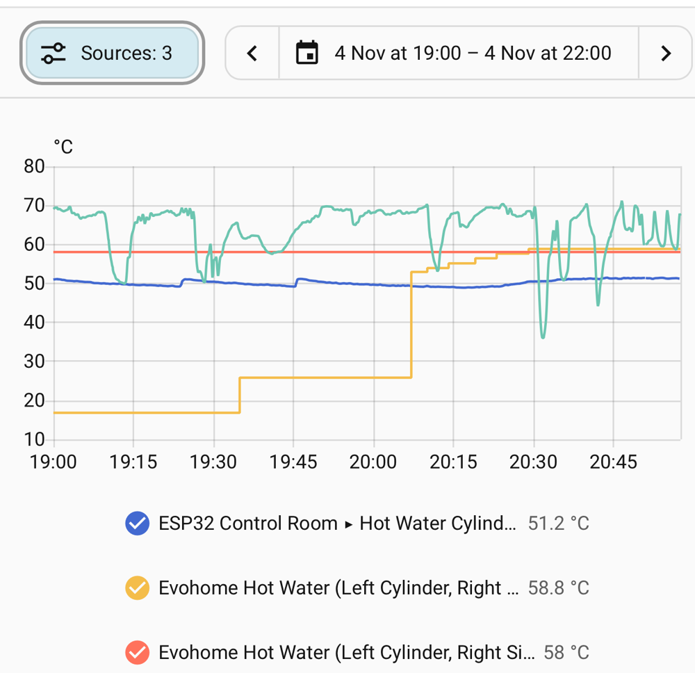

## Cold-inlet pressure (to install with the plumber)
- **Ausla 0-150 psi** stainless transducers (G1/4, 5 V supply, 0.5-4.5 V out), one on each cylinder's cold inlet **after the pressure-reducing valve**, fitted while the plumber is on site.
- **What they show:**
  - **Static pressure** = the pressure reducing valve set point (typically 3 bar).
  - **During reheat, the pressure rises** as the water expands. With a healthy expansion vessel the rise is small.
  - **A steep rise toward the expansion relief valve setting (6 bar here)** means a **failed or flat expansion vessel**, and the tundish will discharge.
  - **Alert thresholds:** warning at **5.0 bar**, critical at **5.5 bar**.
  - **A drop during draws** shows the supply and pressure reducing valve performance.

## Plumber work (planned, one visit)

| Item | Why |
|---|---|
| Replace both cylinders' **expansion vessels** | Ageing vessels; prevents expansion discharge |
| Replace the **expansion relief / pressure-reducing valves** as needed | Same visit; restores the safety set |
| Fit the two **inlet pressure gauge points** (transducer tees) | Instrumentation at the same time |
| Verify the **high-limit cut-out wiring** (in series with each zone valve) | ⚠️ Open safety check from the Evohome install |

## Tundish drip sensors (commissioned 5 Nov 2026)

**Design:**
- Gold-plated contact plates in each tundish's discharge path.
- **Plate power is pulsed:** GPIO21 switches 3V3 to both plates for **150 ms every 5 s**. Pulsing minimises electrolysis and plate corrosion.
- Water bridging a plate turns on its **2N7000 MOSFET**, which pulls the sense pin low (GPIO39, GPIO20; pull-up, inverted).
- **Debounce:** wet only after **2 consecutive** wet samples. Each dry → wet transition increments a **persistent event counter**.
- **In HA:** Tundish (Left/Right) Wet, Tundish Any Wet, the event counts, and a reset button; plus **Running** sensors (below).

**As built:** 2N7000 per plate; gate pull-down **2.2 MΩ** (red-red-black-yellow-brown, ~2.16 MΩ measured in place); the plate's B core lands on a **junction post** (an unconfigured GPIO terminal) with the gate link and pull-down; plate A cores share GPIO21 in a twin ferrule. 3-core screened cable: screen to GND at the ESP32 end only, spare core insulated. Plates must touch only through water, never metal.

| Tundish | Gate post | MOSFET | Sense |
|---|---|---|---|
| Left | IO47 | 2 (S → GND) | GPIO20 |
| Right | IO38 (linked to IO40) | 1 (S → IO41 → GND, G → IO40) | GPIO39 |

**Why 2.2 MΩ:** the water and the pull-down form a divider on the gate; the higher the pull-down, the less water it takes to lift the gate past the 2N7000's ~2-3 V threshold (a 200 kΩ film gives ~3.0 V with 2.2 MΩ, ~2.75 V with 1 MΩ). Much higher and condensation or leakage could trigger it.

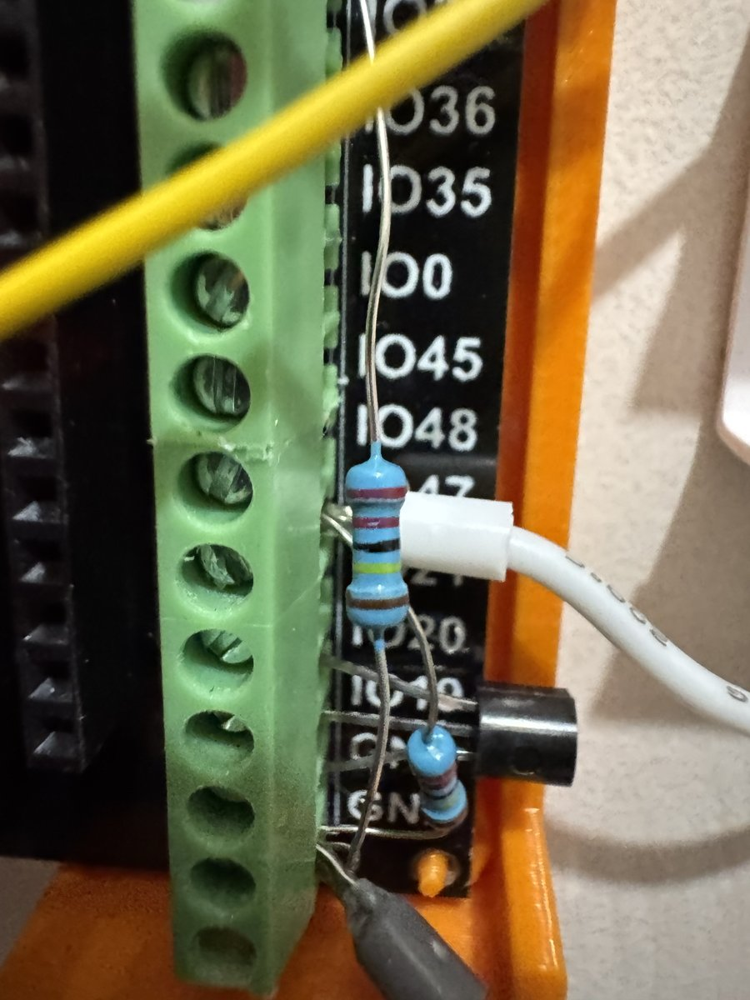

**Commissioning faults found and fixed:**
1. **Both sensors flickered wet/dry while dry:** a missing GND connection left the circuit floating. Stable once connected.
2. **Left and right were swapped:** the cables had landed on the opposite circuits to the plan; the sense pins were swapped in YAML to match the as-built wiring.

**Droplets keep the plate "wet" for hours.** After a discharge, beads of water stay across the tracks, so Wet stays on until they dry, and a **second discharge in that time isn't counted** (no dry → wet change).

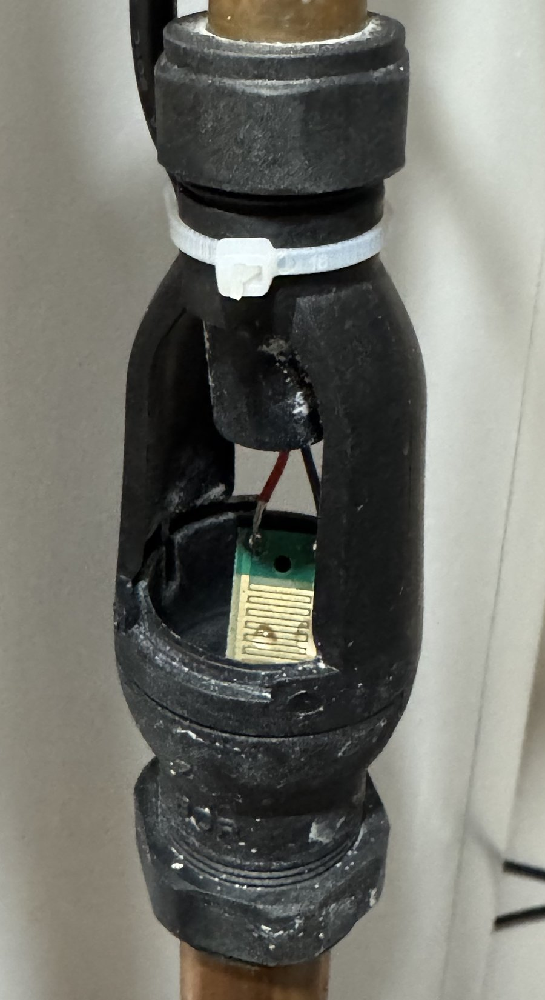

**Two-sensitivity sensing, no rewiring:** each 5 s sample now takes two readings in the same 150 ms pulse:
1. **Wet:** 2.2 MΩ only, any water.
2. **Running:** the firmware switches on the gate post's **internal pull-down** (~45 kΩ, in parallel) for 20 ms, so only well-conducting water lifts the gate. Then off again. The posts are only ever inputs.

Each has its own debounce and counter (Wet Events, **Discharge Events**). Test switches (Test Mode: plate power held on, sampling paused; Test Pull-down: on demand) allow the gate voltages to be measured in place with a meter.

**First result:** on the right plate, Running cleared ~4 min before Wet (17:25 vs 17:29), so the internal pull-down works; on the left both cleared together (17:08), to be checked with the voltage test. The droplets conduct nearly as well as running water for most of the drying time, so the main fix is **mechanical**: clean the plates (E-cloth, IPA), mount them as steeply as possible, and bring the cables in **from below** so nothing spans the air gap.

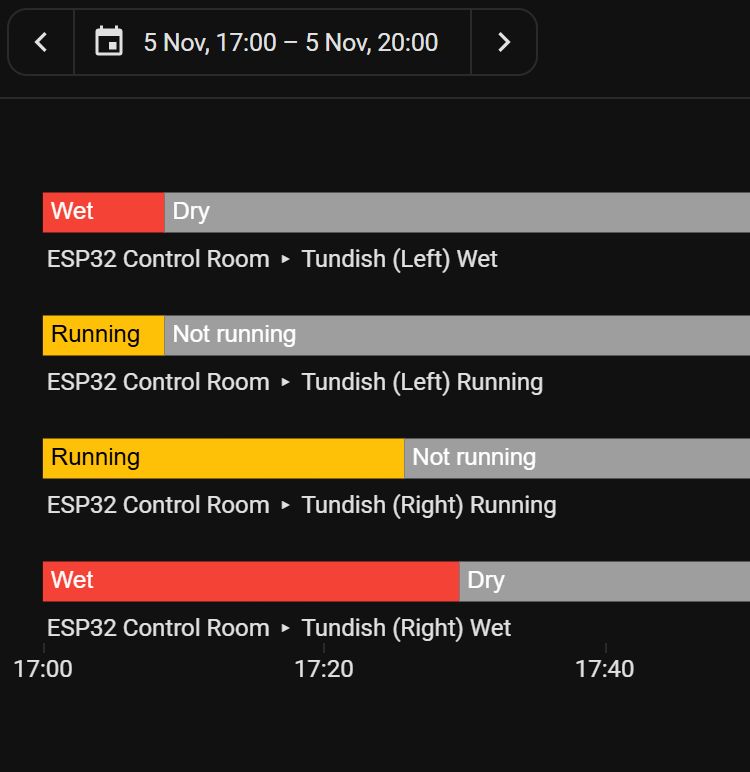

**In service:** the next morning, a plate dried overnight and went wet again when the hot water reheated: the known **weeping relief valve** (awaiting replacement), detected as intended.

**Why it matters:** a tundish discharge is the visible symptom of an unvented-cylinder safety device operating: a failed expansion vessel, an overpressure, or an overheat. It should never be ignored.

## Plumber visit and commissioning, 11 Nov 2026

**Work done:** both expansion vessels replaced (**Flomasta 24 L**, potable, pre-charged **3.5 bar**); the expansion relief valves kept (judged not worth replacing); both inlet gauges fitted **between the pressure reducing valve and the vessel**, so each reads its cylinder's pressure. Cylinders drained down, refilled and re-pressurised.

**Draining an unvented cylinder:** closing the cold inlet and opening hot taps only **de-pressurises** it; water stops once air can't get in. Draining needs the drain cock with a hose to a lower point and a hot tap open to admit air. For a vessel or valve swap, isolating and de-pressurising is usually enough.

**Readings and findings**

| Finding | Detail |
|---|---|
| Static pressure | Both cylinders ~2.85-2.9 bar after the refill, against the utility mains sensor's 2.98 bar (height and tolerance) |
| A false 5 bar | One gauge box's 20k leg had pulled out of its Wago: the pin read 1.52 V, exactly 1.5× the other side (the divider ratio), i.e. ~2.9 bar undivided. Re-seated: 1.0 V. Tug-test every ferrule after work near the boxes |
| Gauges and outlet NTCs swapped | Both pairs were left/right swapped on the ESP32; found by a kitchen (left) draw that dipped the left inlet and warmed the other NTC; corrected in the YAML (inlets IO1 L / IO2 R, outlets IO9 L / IO8 R) |
| pressure reducing valves settle at ~2.5 bar | After the first draw each cylinder settled at **~2.5 bar** and stayed (flow meter showed no flow), though the pressure reducing valves are marked **"pre-set 3.5 bar"** and the mains is ~2.9 bar. Both sides alike. Suspects: scaled strainers or worn cartridges (9 years old). A full-flow kitchen draw dropped the left to 2.1 bar. Plumber's next visit: clean the strainers or replace the cartridges |
| Vessel pre-charge vs working pressure | With the cylinders at ~2.5 bar and the vessels at 3.5 bar, a reheat first rises uncushioned to 3.5 bar; then the vessel takes over (a clear "knee" on both sides). Peak 3.8 bar after a from-cold reheat, well below the 4.5 bar alert and the 6 bar expansion relief valve. Pre-charge to be matched to the working pressure once the pressure reducing valves are sorted |
| Tundishes | **No wet events** during the first reheats with the new vessels |

**Vessel label (Flomasta 24 L potable, WRAS):** factory gas charge **2.7 bar**, **maximum gas charge 3.5 bar**, maximum working pressure 10 bar, working temperature −10 to +70 °C. So the 3.5 bar pre-charge set on fitting is at the vessel's **maximum**, and the factory 2.7 bar is closer to the cylinders' actual working pressure (~2.5-2.9 bar): a point for the pre-charge decision once the pressure reducing valves are sorted.

| | |
|---|---|
| 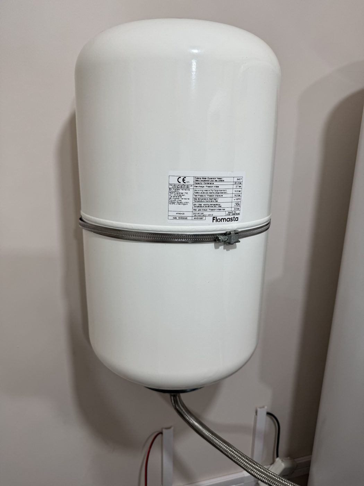 | 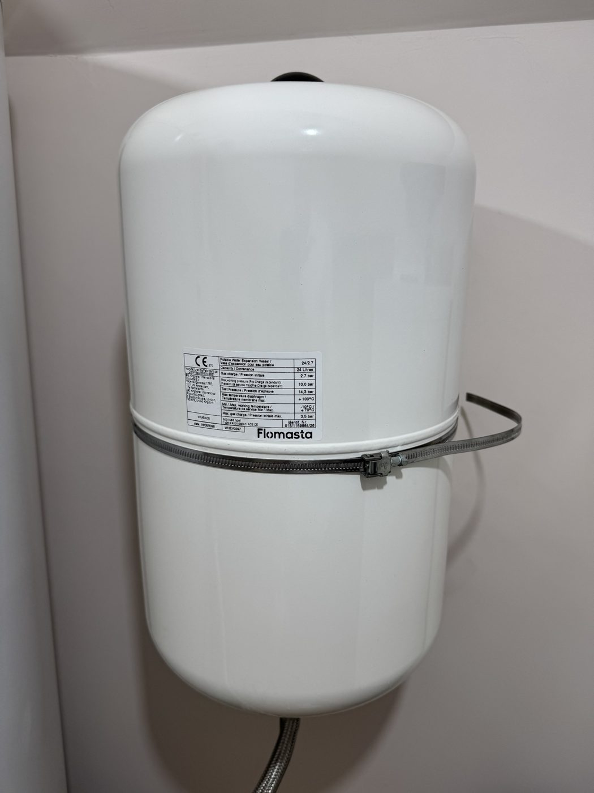 |
| 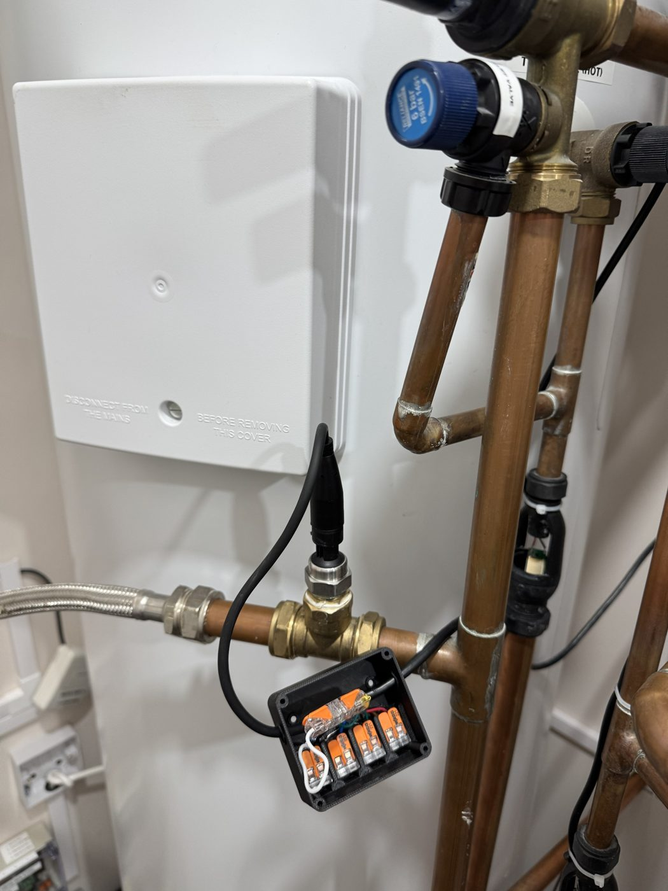 | 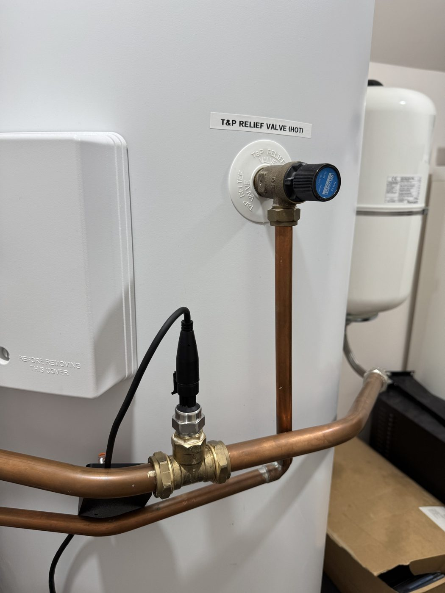 |
| 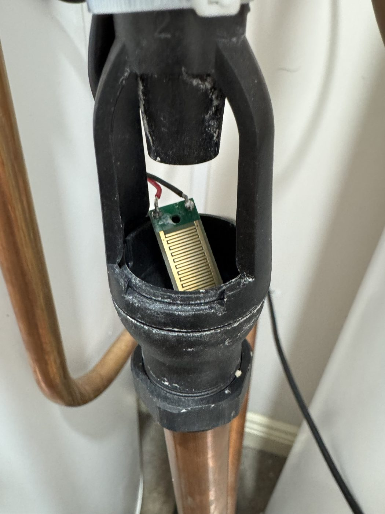 | 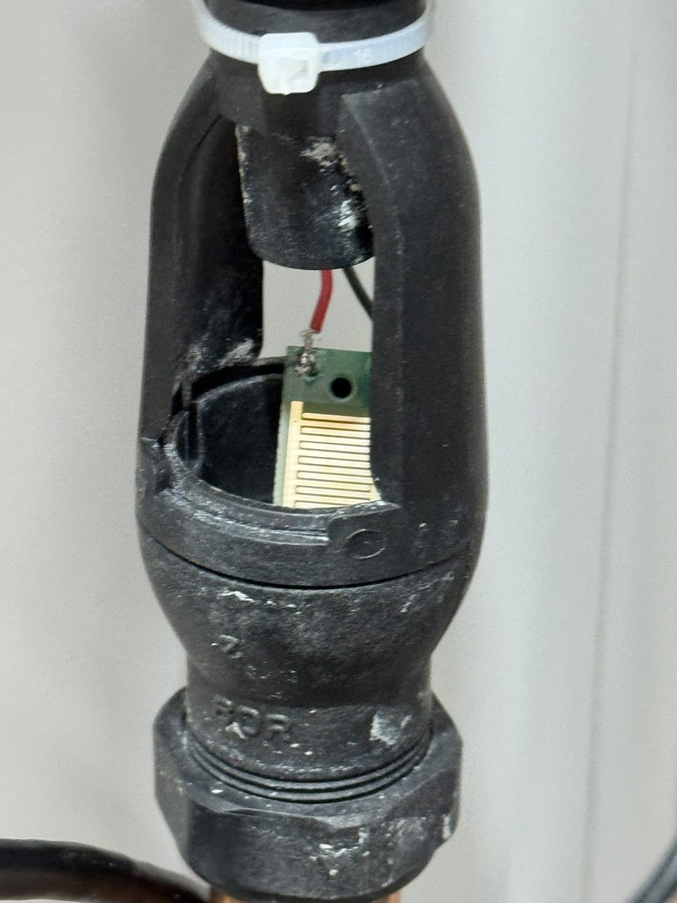 |

**Graphs from the evening of 11 Nov:**

| | |
|---|---|
| 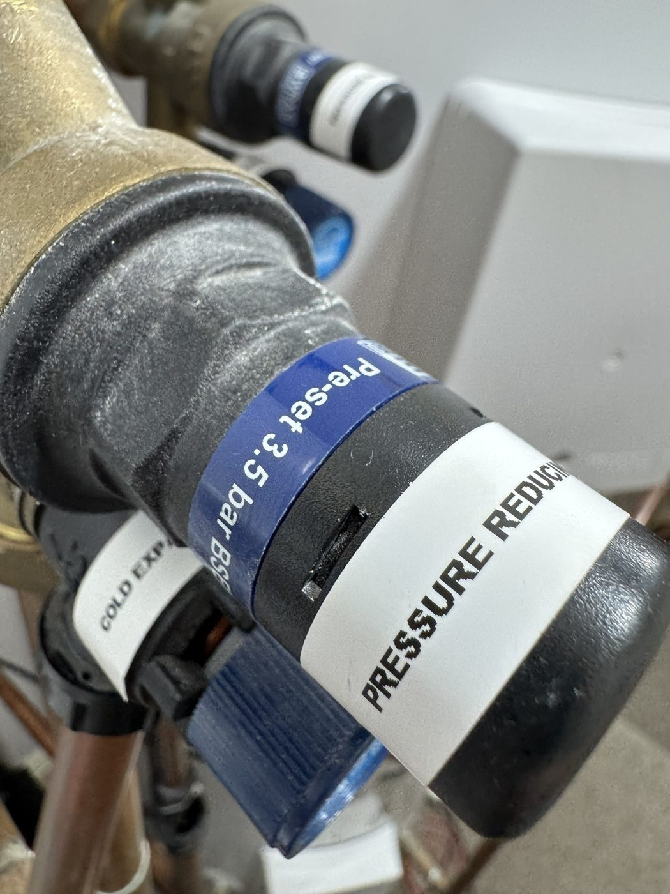 | 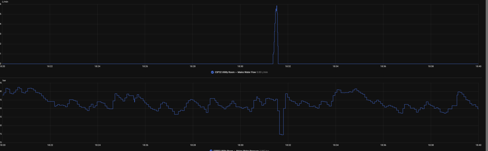 |
| 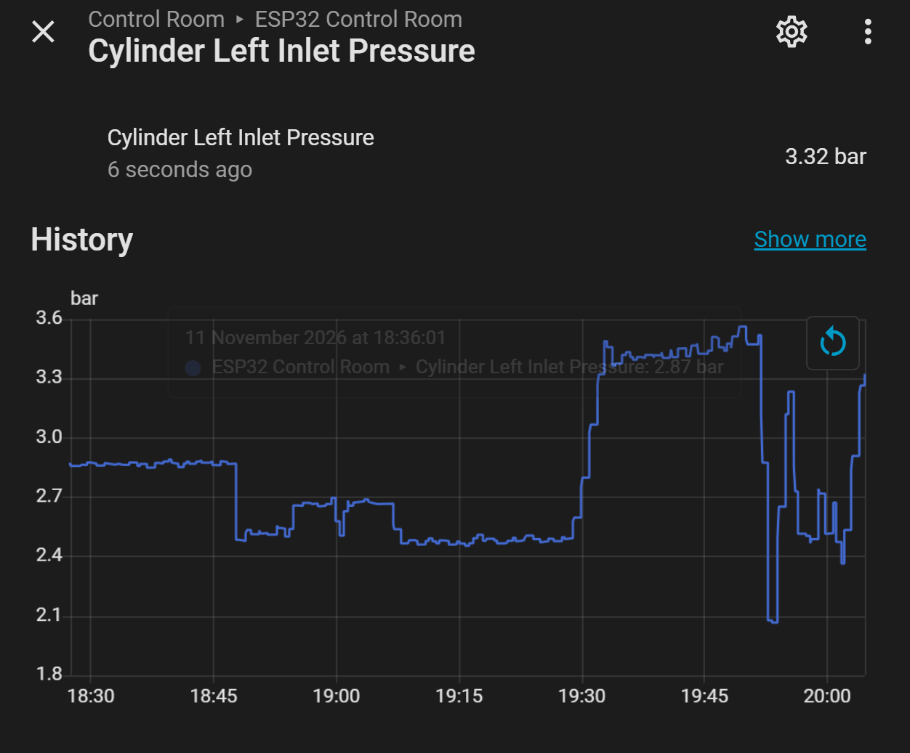 | 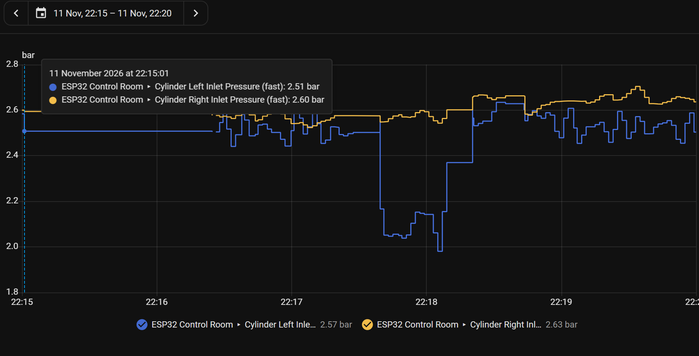 |

**Span check (pending):** above 3.5 bar the vessel's air pressure equals the water pressure, so a tyre gauge on the Schrader valve near a reheat's peak checks the inlet gauge at ~4 bar (below 3.5 bar the air stays at the pre-charge, whatever the water does). A digital inflator (AstroAI L7, 0.05 bar resolution) is on order, to be sanity-checked against another gauge first.

**Tundish water test (right):** wetting the right plate set *Right Wet* and *Right Running* (left stayed dry), confirming the naming. Water then lingered under the plate in the printed holder for over 30 minutes (gate post at 2.9 V of 3.27 V); lifting and drying it brought the post back to 0.30 V. Holder to be remounted steeper, cable from below, with a drain hole. With Test Mode on, sampling pauses and HA holds the last state.

## Alerts (superseded by the alerts package, [doc 15](15-alerts.md))
- Tundish wet → immediate phone alert.
- Cylinder inlet pressure above a threshold → expansion/relief check.
- Hot outlet never reaches 60 °C in 7 days → Legionella reminder.

## Addendum (12-16 Nov 2026)

- **Inlet span checks** with a digital tyre gauge (AstroAI L7, sanity-checked on car tyres) on each vessel's Schrader valve, with water above the pre-charge: right HA 4.06 vs 4.10 bar (gain 1.000); left six readings, mean ratio 1.028 → `inlet_left_span_gain: 1.028` (afterwards 3.82-3.84 vs 3.85). Lessons: test at least ~0.3 bar above the pre-charge (at 3.59 bar the vessel may not yet hold water), and keep checks few (each one bleeds a little vessel air). Both gauges now verified at zero, mid-range (~2.9 bar) and near the top.
- **Outlet NTC position:** the pipe rises out of the cylinder, so after a draw the at-rest reading tracks the top well (54 → 32 °C within ~2 min when the right cylinder emptied).
- **Mains under flow:** the mains sags ~3.0 → ~2.4 bar at 7-9 L/min; each inlet group loses a further ~0.55-1.0 bar under flow. The left "settling below mains" was a part-closed cold isolating valve, fixed. Hot-only tap tests and the strainers: [doc 17](17-cylinder-inlets-height-offset-tests-and-trend.md#5-inlet-group-losses-12-nov).
- **Right tundish counter (10):** real discharges on 10 Nov evening and 11 Nov morning (the old, failed vessels) plus the 11 Nov water test; none since the new vessels, including two reheats from empty peaking ~4.1 bar. Counter reset 12 Nov.
- **Vessel pre-charge** (3.5 bar on a ~2.5 bar supply) and the 3.7-3.8 bar post-reheat level: [doc 17](17-cylinder-inlets-height-offset-tests-and-trend.md#2-why-the-inlets-sit-at-37-38-bar-after-a-reheat).

## Addendum (22 Nov 2026): the right relief valve starts to weep

Two wet events on the right tundish, the first since the new vessels (11 Nov):

| | 08:45:23 | 16:11:57 |
|---|---|---|
| Right cylinder heating? | No: idle 17 min (reheat ended 08:28) | No: idle 6 h 11 min (reheat ended 10:00) |
| Draw on the right? | No | No (none since ~09:35) |
| Inlet pressure | 3.96-4.00 bar, steady | 3.68-3.72 bar, steady |
| Spike or transient (2 s data) | None | None |
| Held near that pressure first | ~14.5 h (after the 21 Nov 18:30 reheat from the coldest start yet, 11.7 °C) | ~6 h |

**History (12 Nov onwards):** the same cylinder held **4.09 bar** (12 Nov, 2.4 h at or above 4.0 bar) and **3.99 bar for 8.6 h** (21-22 Nov overnight) with no drip. So it isn't a new high in pressure: a relief valve seat no longer seals reliably at ~3.7-4.0 bar, and it got worse within the day. The expansion relief valve is the likeliest (it discharged on 10-11 Nov with the old vessels); the T&P relief valve can't be ruled out from here because the two discharge pipes join before the tundish. Unvented safety kit: a G3 plumber job.

**What sets the held pressure:** a full reheat from cold after a big draw (probe at the start 11.7-17.9 °C → 3.9-4.1 bar); top-ups from 35-55 °C settle at 3.6-3.86 bar. Frost only matters through a colder mains (~0.05-0.1 bar). The 3.5 bar vessel pre-charge on a ~2.5 bar supply is why the cylinder sits near 4 bar for hours after each full reheat.

**Interim:** a ~10 s hot draw from a right-cylinder tap after each reheat drops it to supply pressure (~2.5 bar) until the next one.

**Vessel watch:** if the vessel were losing its air charge, peaks after full reheats would rise. They haven't (4.09 on 12 Nov, 3.7-4.0 since); a daily check for peaks above ~4.1 bar is on the list.

**Sensor note:** a drop left sitting across the plates keeps "running" on until it dries (08:45-09:12, 16:12-16:37). Read the **start time** as the event and the duration as nothing more than how long the plate stayed wet.

## Addendum (23-26 Nov 2026): six right tundish events, water hammer tested and ruled out

**Events on the right cylinder's tundish** (the left has had none):

| # | When | What the cylinder was doing | Right inlet pressure |
|---|---|---|---|
| 1 | 22 Nov 08:45 | idle, reheat ended 08:28 | steady 3.96-4.00 bar |
| 2 | 22 Nov 16:11 | idle since 10:00 | steady 3.66-3.73 bar |
| 3 | 23 Nov 07:25 | during a long shower, reheat running | 0.7-1.5 bar (drawing) |
| 4 | 24 Nov 07:21 | 18 s after a long shower stopped | rising from 1.55 bar |
| 5 | 25 Nov 07:18 | during a long shower, reheat running | 0.75-0.8 bar (drawing) |
| 6 | 26 Nov 03:12 | idle overnight, no draw, no reheat since the previous morning | steady 3.45 bar |

**Water hammer (24-25 Nov): ruled out.** Event 4 came seconds after a shower closed, so the first theory was a pressure surge lifting a weak expansion relief valve. The normal inlet sensors can't see a surge: they sample once a second and then take a median of 7 and an average of 5. So two temporary diagnostic sensors were added to the control-room firmware ("Cylinder Left/Right Inlet Pressure Peak (diag)": a 20 ms ADC read, maximum over 2 s; flashed 24 Nov 22:08). At rest they read within 0.05 bar of the normal sensors. When the shower closed on 25 Nov (07:28:50), the right inlet rose from 1.5 to 2.96 bar and then climbed smoothly to 3.5 bar over the next few minutes: **no spike, no overshoot**. The same held on both cylinders all morning. The 24 Nov "jump" was a smoothed level change, not a surge.

**Condensation (25-26 Nov): ruled out.** Events 3-5 all came during or just after long morning showers, so cold mains running through the inlet group could have made the pipework sweat into the tundish. Event 6 came at 03:12 with no water flowing, and after the next morning's showers there were no water beads on the pipes above the tundish.

**Working theory: the right expansion relief valve's seat is passing.** A dirty or worn seat lets water through at any pressure, not only near its 6 bar setting. Drops collect in the discharge pipe and reach the tundish plates at irregular times, whatever the cylinder is doing. That fits all six events, including the idle ones at 3.45-4.0 bar, well below pressures this cylinder has held dry for days. The two discharge pipes (expansion relief and T&P) join before the tundish, so the tundish can't say which valve; the T&P discharge would be hot, and none of the events followed a temperature excursion. **This is a G3 job for the plumber.**

**Also for the plumber:** under a long draw the right inlet falls to **0.75 bar**, against 1.15 bar on the left. That points to a partly blocked inlet strainer or a weak pressure reducing valve on the right inlet group. The right inlet's highest reading after a full reheat was 3.96 bar (25 Nov), within the vessel watch limit (≤ ~4.1 bar).

**Why the left inlet reads ~2.4 bar overnight:** with no reheat and no draw for many hours, the trapped pressure above the pressure reducing valve relaxes back towards the mains supply level. The right held 3.45 bar on the same night.

The peak sensors stay in for now: they turned out to matter for something else (see [doc 19](19-control-room-esp-api-drops.md)).

## Addendum (26-27 Nov 2026): event 7, and the full map
- **Event 7: 26 Nov 18:12:30-18:39:40**, idle: no reheat, no hot draw, inlet only 2.44-2.54 bar, no pressure spike. The seat passes at low pressure too.
- **All seven events against the raw data** (21-26 Nov): three began at a quick pressure rise (a shower closing ×2, the pressure reducing valve topping up), one mid-shower, three at steady pressure with nothing happening (3.45-4.0 bar). The left tundish stayed dry throughout. No single trigger: a passing seat; disturbances may release a drop that has built up at the outlet.
- **Burner timing checked and ruled out:** 344 burner starts in the period; only event 7 began within a second of one. Backflow up the shared discharge was also ruled out (joins several metres away and lower, no smell, no condensate).
- **Kept separate from the heating leak:** the cylinders are mains-pressure water, topped up automatically through the pressure reducing valve, so a tundish drip never shows on the boiler gauge; a cylinder coil leak would *raise* the boiler pressure, not lower it.
- Plumber: replace the right expansion relief valve cartridge; check the right inlet strainer / pressure reducing valve.
