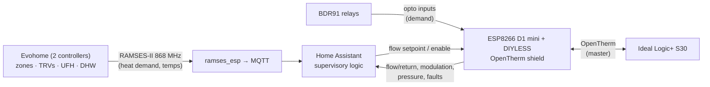

# 07 · Planned: OpenTherm Boiler Control with PID, Alongside Evohome

[← Back to README](../README.md)

## Goal
Move the Ideal Logic+ S30 from **on/off** firing (switched live from the BDR91s) to **modulating flow-temperature control over OpenTherm**. Evohome stays in place for zone control and **reports** demand, but **doesn't control the boiler**.

## Why this design
- Honeywell's own OpenTherm bridge works with **one** Evohome controller. This house has **two** controllers and four BDR91s on one boiler, so a single Honeywell OpenTherm unit can't replace them.
- The Logic+ is assumed **not** to respond to the switched live and OpenTherm at the same time, so the **switched lives are disconnected** when OpenTherm is in control, and HA takes over boiler demand. The **opto board** still reports every BDR91 call, so Evohome's demand is fully preserved as an input.
- The DIYLESS shield sits on its **own ESP8266 D1 mini node**, keeping control separate from the (full) control-room monitoring board.

## Decision history: why OpenTherm can't just be "monitored"

| Step | Finding | Consequence |
|---|---|---|
| 1 | The **Ideal Logic+ System S30 supports OpenTherm** (manufacturer FAQ). Its OT terminals are currently **vacant**, because Evohome drives the boiler with 230 V switched lives from BDR91s | OpenTherm is available as an extra capability |
| 2 | **A "listen-only" gateway doesn't help here.** An OT gateway monitors traffic between a thermostat and the boiler, but with BDR91 switching there's **no OpenTherm traffic on the wire** to listen to | Passive monitoring is ruled out |
| 3 | **A master adapter isn't a passive tap.** A DIYLESS master shield running ESPHome's OpenTherm component *is* a thermostat: even with only sensors configured it sends Status and CH-enable frames | Connecting one turns OT into a control path |
| 4 | **Risk:** many Ideal boards then treat OT as the control path and may **ignore or fight the switched live** | Running OT alongside the BDR91 switched lives isn't safe to assume |
| 5 | **Honeywell's own OpenTherm bridge** serves **one** Evohome controller. This house has **two** controllers and four BDR91s on one boiler | The off-the-shelf route doesn't fit |
| 6 | **Decision:** DIYLESS master shield on its **own dedicated ESP8266 node**; **switched lives disconnected** whenever OT is in control; the **opto board** keeps every BDR91 call visible as an input; **interlocked relay changeover** between OT/HA and Evohome on/off | HA becomes the boiler controller, with Evohome demand as input and a one-switch fallback |

**What OpenTherm adds** over Evohome's TPI and on/off control: **flow-temperature modulation**, i.e. lower flow temperatures, longer burns, fewer cycles and better condensing, plus boiler telemetry.

## Hardware and wiring (planned)

| Item | Detail |
|---|---|
| OpenTherm interface | **DIYLESS Master OpenTherm Shield** (bought) |
| Host | **Dedicated node:** a **diymore ESP8266 D1 mini**, with the shield plugged on, on Wi-Fi, in a **3D-printed enclosure** by the boiler. Awaiting delivery |
| Why a separate node | The control-room ESP32-S3 is **full**. Keeping boiler *control* on its own node also separates it from the *monitoring* board, so a fault, update or reboot on one can't take down the other. That's the same separation a BMS keeps between supervisory monitoring and plant controllers |
| Pins | The shield's fixed D1-mini pins: OT **in = D2 (GPIO4)**, OT **out = D1 (GPIO5)** ⟨confirm against the shield's documentation⟩ |
| Boiler connection | Two-wire OT pair to the boiler's OpenTherm terminals. **Polarity usually doesn't matter. 230 V must never reach these terminals.** Confirm the terminal identification (and any factory link) against the installation manual or with a Gas Safe engineer; don't assume "vacant = ready" |
| Changeover | Relays on the OT pair and the four BDR91 switched lives, with force-guided contacts so OT and switched-live control can never be connected together |

## ESPHome configuration skeleton (planned, not deployed)

```yaml
# Native ESPHome OpenTherm component (the older community repo is archived).
esphome:
  name: esp8266-opentherm
  friendly_name: Boiler OpenTherm

esp8266:
  board: d1_mini

# Wi-Fi, API (encrypted), OTA and MQTT as per the fleet standard, all via !secret

opentherm:
  in_pin: GPIO4           # D2 - DIYLESS shield OT in  (confirm)
  out_pin: GPIO5          # D1 - DIYLESS shield OT out (confirm)

sensor:
  - platform: opentherm
    t_boiler:  {name: "OT Boiler Flow Temperature"}
    t_ret:     {name: "OT Boiler Return Temperature"}     # official id is t_ret
    rel_mod_level: {name: "OT Modulation Level"}
    ch_pressure: {name: "OT CH Pressure"}                  # may not be reported by this boiler; test

binary_sensor:
  - platform: opentherm
    flame_on: {name: "OT Flame On"}                        # official id is flame_on
    fault_indication: {name: "OT Fault"}

# Control outputs (ch_enable, t_set) are added only at the control stage,
# with the switched lives disconnected via the changeover relays.
```

**Points to verify when connected:**
- Whether this boiler reports **CH pressure** over OpenTherm. It's commonly reported that it only has an internal binary pressure switch, so the analogue transducer stays the pressure source either way.
- The supported **data IDs**: flow/return, modulation, DHW, fault codes.
- **Commissioning:** choose a day when a period without heat is acceptable, and keep the changeover set to Evohome until the OT path is proven.

## Architecture (planned)



| Element | Role |
|---|---|
| **DIYLESS OpenTherm shield** on a dedicated ESP8266 D1 mini (ESPHome OpenTherm component) | OpenTherm **master**: CH enable, flow setpoint, DHW enable; reads boiler flow/return, modulation level, pressure and fault codes |
| **Evohome** | Unchanged zone control. Its demand (RAMSES heat demand + BDR91 states via opto) is an **input** |
| **Home Assistant** | Supervisory logic: weather compensation, demand aggregation, DHW priority |
| **Fail-safe and switch-over** | Relays on the **OpenTherm pair** and on the **four BDR91 switched lives** allow a clean, **interlocked** changeover between *HA/OpenTherm control* and the *original Evohome on/off control*, using force-guided contacts so both can never be connected at once. Used for testing, and as the fallback if the ESP or HA fails |

## Control strategy (planned)
1. **Weather-compensated base curve:** flow setpoint from outdoor temperature (e.g. 55 °C at -3 °C outdoors down to 30 °C at 15 °C).
2. **Demand trim:** raise the setpoint according to the aggregated zone heat demand from RAMSES-II (how far rooms are from target and how many are calling).
3. **PID on the flow temperature** (boiler side), or **PI on a demand-weighted room error** (house side) to trim the curve, with:
   - **anti-windup** (clamped integral, frozen while the boiler is at minimum or maximum modulation)
   - **rate limiting** of setpoint changes
   - **minimum on/off times** to avoid short-cycling
   - a **deadband** around the target
4. **DHW priority:** a cylinder demand (BDR91 opto) gives a high flow setpoint (e.g. 70 °C) for the cylinder coils, then a return to the CH curve.
5. **UFH limit:** the UFH has its own mixing at the manifold. The flow setpoint respects the radiator needs, and UFH demand is weighted separately.

## Safety and compliance
- OpenTherm is a low-voltage two-wire bus on the boiler's OT terminals. **No gas work.** Connect with the boiler isolated, inside the terminal area only.
- The boiler keeps all its own safety limits; OpenTherm only requests a setpoint.
- The interlock ensures there's always a heating path.

## Status
- DIYLESS OpenTherm shield **bought**; diymore ESP8266 D1 mini **on order**; 3D-printed enclosure to print; the switch-over relay arrangement is **designed**.
- Not yet installed. Comes after the monitoring in this repo is commissioned, so there's a **before/after baseline** (cycles/hour, flow temperatures, gas use) to compare against.
- PID tuning becomes BMS portfolio project #8 (PID loop with anti-hunt).
