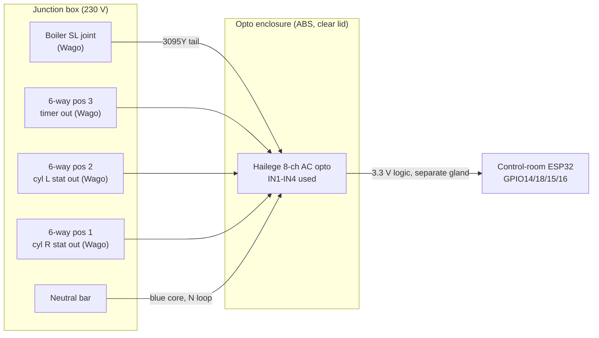

# 11 · Opto Board Installation: Tap Points, Enclosure and Wiring

[← Back to README](../README.md)

Follows the October 2026 junction box survey ([Evohome repo, A4](https://github.com/the-control-cabinet/evohome-heating-controls-ramses-integration/blob/main/docs/A4-junction-box-survey-and-wiring.md)). Status: **materials in hand, install pending** (the box stays isolated until the tidy-up is done).

## 1. Which signals, and why only four

RAMSES-II already reports **every BDR91's relay state**, so tapping the relay outputs would duplicate points. The opto board takes the signals the radio **can't** see:

| Input | Tap point (junction box) | Live when | What it adds |
|---|---|---|---|
| **IN1 Boiler call** | Boiler switched-live joint | Anything fires the boiler (radiator relay directly; UFH and cylinder valves via end switches) | Confirms the boiler is actually being asked to fire |
| **IN2 Hot water enabled** | 6-way pos 3 (TS715Si output) | The Danfoss timer output is on | The timer still gates hot water; this proves it's on |
| **IN3 Cyl L stat passing** | 6-way pos 2 | Cyl L relay calling **and** its stat and cut-out closed | Relay calling with IN3 off = stat satisfied or **cut-out tripped** |
| **IN4 Cyl R stat passing** | 6-way pos 1 | As above, right cylinder | As above |
| IN5-IN8 | Spare | | Candidates: UFH valve drive (pos 4), relay outputs for a physical cross-check of RAMSES |

Not separable at the box: **radiator demand on its own**. The radiator relay's output is joined straight into the boiler switched-live joint, so it reads as "any boiler call". Radiator demand comes from RAMSES-II.

## 2. Hardware

| Item | Choice | Reason |
|---|---|---|
| Opto module | Hailege H-1-1832-8CH, **136 × 56 mm** | Already fitted beside the box; logic side on **3.3 V** |
| Enclosure | **200 × 120 × 56 mm IP65 ABS, clear lid** | About 28 mm clearance all round the board; the clear lid shows the input LEDs **without opening a 230 V enclosure** |
| Mounting | M3 **nylon** standoffs on a printed (PETG) plate with an integral **barrier** between the 230 V terminals and the logic pins | Board fixed, not loose; segregation inside a rated box (the printed parts carry no current) |
| 230 V tails | **3095Y 5-core 0.75 mm² heat-resistant flex**: brown/black/grey = three signals per cable, blue = neutral, G/Y earthed at the box | One cable type for the job; protected by the B6 RCBO |
| Entries | PG11 / M16 glands for the 5-core, PG7 for the logic cable, on **different sides** | Mains and logic enter separately |
| Logic cable to ESP32 | Mains-rated cores (insulated for the highest voltage in the enclosure) | Required where low-voltage wiring shares an enclosure with 230 V |
| Junction box joints | Wago 221-413 / 221-415 at the four tapped joints | A tap adds a third core, which a choc block can't take properly |

### Inside the enclosure
| Item | Detail |
|---|---|
| Signal cores IN1-IN4 | Straight into the board's L1-L4 terminals |
| Neutral distribution | **1× Wago 221-415:** the incoming blue plus four short blue links to N1-N4 |
| Earth | **1× Wago 221-415** joining the opto cables' green/yellow cores (the board has no earth terminal; the box is ABS) |
| Mount | One printed **2-slot mount for 5-way Wagos**, on the 230 V side, away from the logic outputs |
| Logic outputs | Board terminals to the logic cable; never through the 230 V Wagos |

## 3. Install sequence
1. Isolate the **Boiler B6 RCBO**, lock off, prove dead.
2. Rebuild the four tapped joints in Wagos, one at a time, against the terminal map; label each.
3. Run the tails in lidded trunking; label every core at both ends (e.g. "IN3 Cyl L stat, 6-way pos 2").
4. Fit the board on its plate; terminate with ferrules; loop the neutrals if the board allows a common N.
5. Logic side: 3.3 V, GND and four outputs to the ESP32 (internal pull-ups, 100 ms debounce, `inverted: true` expected).
6. Continuity-check every tap; close both enclosures; re-energise; **TS715Si on permanent ON**.

## 4. Commissioning tests

| Test | Expected |
|---|---|
| No demand anywhere | IN1-IN4 off |
| Timer permanent ON | IN2 on |
| Cylinder L call (Evohome) | RAMSES relay on, IN3 on, then IN1 on once the valve opens |
| Cylinder L stat turned down below water temperature | RAMSES relay on, **IN3 off**, IN1 off (rule F15) |
| Radiator call only | IN1 on, IN3/IN4 off |
| Each channel | Polarity confirmed; flip `inverted:` if needed |
