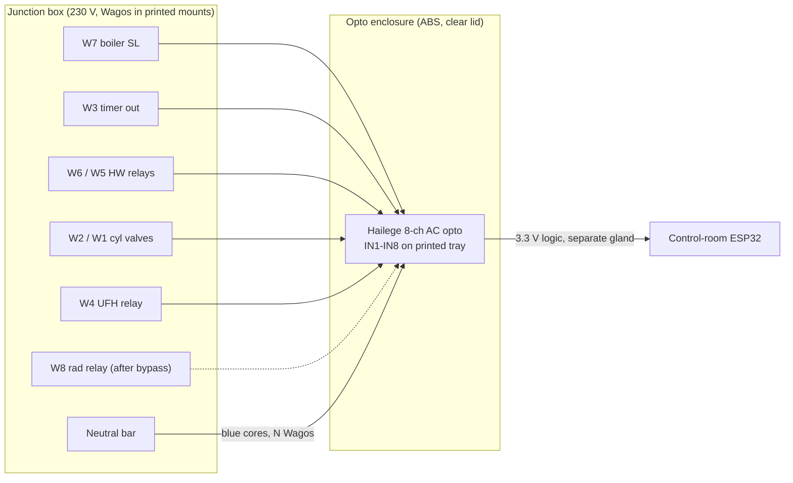
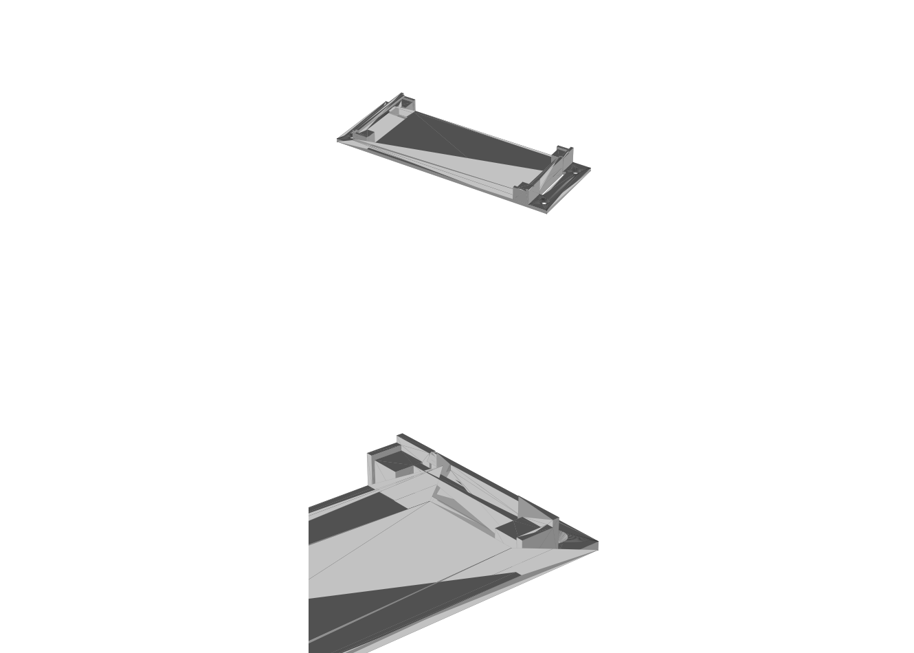
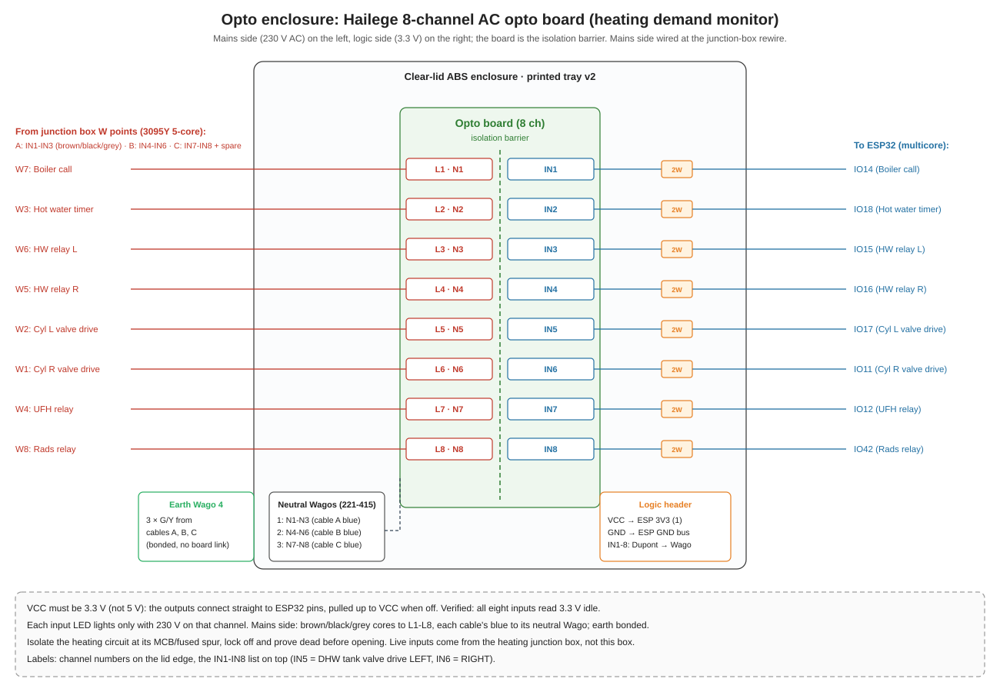
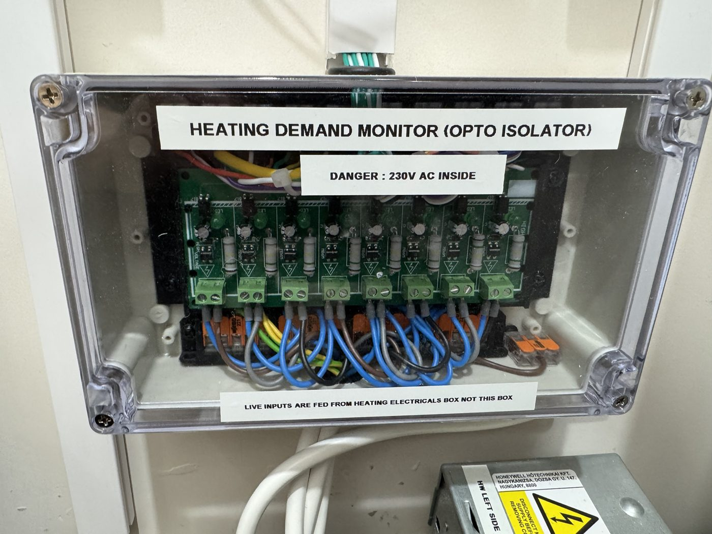

# 11 · Opto Board Installation: Tap Points, Enclosure and Wiring

[← Back to README](../README.md)

Follows the October 2026 junction box survey ([Evohome repo, A4](https://github.com/the-control-cabinet/evohome-heating-controls-ramses-integration/blob/main/docs/A4-junction-box-survey-and-wiring.md)). Status: **materials in hand, tray printed (v2), install pending** (the box stays isolated until the tidy-up is done).

## 1. Which signals: all eight inputs

RAMSES-II reports every BDR91's relay state, but not what happens **after** the relay: whether the stat passes, whether the valve is driven, whether the boiler is actually asked to fire. The board now taps all eight points in the junction box, each at one of the planned Wago joints (W1-W8 in [A4](https://github.com/the-control-cabinet/evohome-heating-controls-ramses-integration/blob/main/docs/A4-junction-box-survey-and-wiring.md)):

| Input | Tap (Wago) | Live when | What it adds |
|---|---|---|---|
| **IN1 Boiler call** | W7 switched-live joint | Anything fires the boiler | Confirms the boiler is being asked to fire |
| **IN2 Hot water timer** | W3 timer output | The TS715Si output is on | The timer still gates hot water; this proves it's on |
| **IN3 HW relay L** | W6 | Cyl L relay calling, feeding its stat | With IN5 off: stat satisfied or **cut-out tripped** |
| **IN4 HW relay R** | W5 | As IN3, right cylinder | As IN3 |
| **IN5 Cyl L valve drive** | W2 | Stat passing, valve motor driven | Stat and valve path proven |
| **IN6 Cyl R valve drive** | W1 | As IN5, right cylinder | As IN5 |
| **IN7 UFH relay** | W4 | UFH relay calling, UF valve driven | Physical cross-check of RAMSES |
| **IN8 Radiator relay** | W8 (new joint) | Radiator relay calling | **Live only after the TF/MF re-wire**, which waits for the bypass |

Until W8 exists, the radiator relay feeds the switched-live joint directly, so **IN1 on with IN5-IN7 off = radiators calling**. That logic sits on the board; RAMSES-II adds the full picture in HA. A hardware interposing relay for the radiator signal was considered and rejected (more 230 V wiring for a signal the logic already gives).

## 2. Hardware

| Item | Choice | Reason |
|---|---|---|
| Opto module | Hailege H-1-1832-8CH, **138 × 56 mm**, PCB 1.65 mm | Already fitted beside the box; logic side on **3.3 V** |
| Enclosure | **200 × 120 × 56 mm IP65 ABS, clear lid** | About 28 mm clearance all round the board; the clear lid shows the input LEDs **without opening a 230 V enclosure** |
| Mounting | Printed PETG **tray (v2)** holding the board by its edges, with a flexure clip and an integral **barrier** between the 230 V terminals and the logic pins ([§2.1](#21-printed-tray)) | Board fixed, not loose; segregation inside a rated box (the printed parts carry no current) |
| 230 V tails | **3095Y 5-core 0.75 mm² heat-resistant flex**: brown/black/grey = three signals per cable, blue = neutral, G/Y earthed at the box | One cable type for the job; protected by the B6 RCBO |
| Entries | PG11 / M16 glands for the 5-core, PG7 for the logic cable, on **different sides** | Mains and logic enter separately |
| Logic cable to ESP32 | Mains-rated cores (insulated for the highest voltage in the enclosure) | Required where low-voltage wiring shares an enclosure with 230 V |
| Junction box joints | Wago 221-413 / 221-415 at all the planned joints (W1-W8), in printed mounts | A tap adds a third core, which a choc block can't take properly |

### Inside the enclosure
| Item | Detail |
|---|---|
| Signal cores IN1-IN8 | Straight into the board's L1-L8 terminals |
| Neutral distribution | **3× Wago 221-415, linked:** the incoming blues plus short links to N1-N8. Check first whether N1-N8 are already common on the PCB; if so, one link is enough |
| Earth | **1× Wago 221-415** joining the opto cables' green/yellow cores (the board has no earth terminal; the box is ABS) |
| Mount | One printed **4-slot mount for 5-way Wagos** (3 neutral + 1 earth), on the 230 V side, away from the logic outputs |
| Logic outputs | Board terminals to the logic cable; never through the 230 V Wagos |

### 2.1 Printed tray

| Version | Result |
|---|---|
| v1 | Too narrow by about 1 mm, edge groove too shallow, and the clip snapped: printed with its layers across the bending direction |
| **v2** | +1 mm width, 0.5 mm headroom over the PCB, and a **horizontal flexure clip** so the layers run along the bend |

Files: [STL](../hardware/opto-tray/opto-board-tray-v2.stl) · [OpenSCAD source](../hardware/opto-tray/opto-board-tray-v2.scad). Print in PETG, clip lying flat.

## 3. Install sequence
1. Isolate the **Boiler B6 RCBO**, lock off, prove dead.
2. Rebuild the joints in Wagos (W1-W8), one at a time, against the terminal map; label each.
3. Run the tails in lidded trunking; label every core at both ends (e.g. "IN3 Cyl L stat, 6-way pos 2").
4. Fit the board on its plate; terminate with ferrules; loop the neutrals if the board allows a common N.
5. Logic side: 3.3 V, GND and eight outputs to the ESP32 (internal pull-ups, 100 ms debounce, `inverted: true` expected).
6. Continuity-check every tap; close both enclosures; re-energise; **TS715Si on permanent ON**.

## 4. Commissioning tests

| Test | Expected |
|---|---|
| No demand anywhere | IN1-IN8 off |
| Timer permanent ON | IN2 on |
| Cylinder L call (Evohome) | RAMSES relay on, IN3 on, IN5 on, then IN1 on once the valve end switch closes |
| Cylinder L stat turned down below water temperature | RAMSES relay on, IN3 on, **IN5 off**, IN1 off (rule F15) |
| Radiator call only | IN1 on, IN5-IN7 off (IN8 on once W8 is live) |
| UFH call only | IN7 on, then IN1 on via the UF valve end switch |
| Each channel | Polarity confirmed; flip `inverted:` if needed |

## 5. As built: enclosure schematic and status (10 Nov 2026)

- **Enclosure finished** and labelled (DANGER 230 V; live inputs fed from the heating junction box; channel numbers on the lid edge and the IN1-IN8 list on top).
- **Logic side wired and tested:** VCC moved from 5 V to **3.3 V** (the outputs connect straight to ESP32 pins); all eight inputs read 3.3 V idle and **off** in HA.
- **Mains side:** cables A/B/C to the neutral and earth Wagos and L1-L8, connected at the junction-box rewire; then each input tested against a real demand.
- **Input LEDs** light only with 230 V on that channel, so all are off until then (expected).

