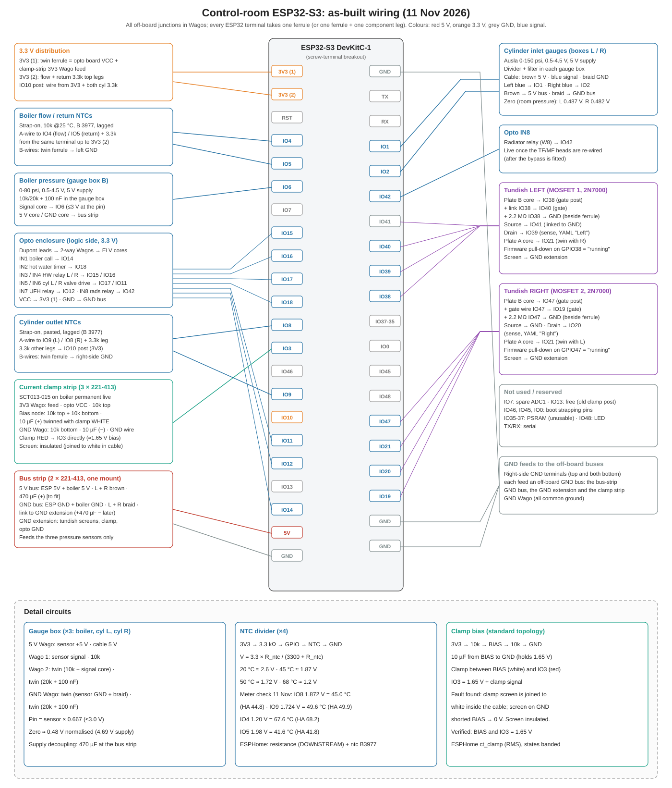

# 12 · Control-Room ESP32: As-Built Wiring Schematic

[← Back to README](../README.md)

The complete as-built wiring of the control-room board after the off-board rework of 10-11 November 2026: every terminal, every sensor's conductors, the posts, and each off-board junction (bus strip, clamp strip, gauge boxes, opto enclosure).

## Design rules this layout follows

- **One ferrule per terminal** (a twin ferrule where two conductors share it), plus at most **one component leg** beside it. Components never hang between a terminal and a loose Wago.
- **Components live where there's room:** each pressure sensor's divider and filter sit in its **gauge box**; the clamp's bias network on its own **strip**; the NTC resistors bridge **neighbouring terminals** on the board (rigid at both ends).
- **Posts** (unconfigured GPIO terminals used as junctions) only for **low-impedance** circuits: **IO10** carries 3.3 V for the cylinder NTCs. Never for the 2 MΩ tundish gate nodes, where a pin's leakage or boot-time pull would shift the reading.
- **Supplies kept apart:** 5 V (pressure sensors only) and 3.3 V (NTCs, clamp bias, opto logic) never share a Wago; the GND bus sits between them on the strip.
- **Pins:** analogue inputs on **ADC1** only (Wi-Fi blocks ADC2). On the right-hand side, only GPIO1 and GPIO2 are ADC1, which is why the two cylinder gauges sit there and the boiler gauge moved to GPIO6.

## Pin table

| Terminal | Use | Terminal | Use |
|---|---|---|---|
| 3V3 (1) | Opto VCC + clamp-strip 3V3 feed | GND | GND |
| 3V3 (2) | Flow + return 3.3k | IO1 | Cylinder L gauge (blue) |
| IO4 | Flow NTC + 3.3k | IO2 | Cylinder R gauge (blue) |
| IO5 | Return NTC + 3.3k | IO42 | Opto IN8 (radiator relay) |
| IO6 | Boiler gauge signal | IO41 | MOSFET 1 source (→ GND) |
| IO7 | Spare ADC1 | IO40 | MOSFET 1 gate |
| IO15 / IO16 / IO17 / IO18 | Opto IN3 / IN4 / IN5 / IN2 | IO39 | Tundish L sense |
| IO8 | Cylinder R outlet NTC + 3.3k | IO38 | Gate post: L plate B + 2.2 MΩ |
| IO3 | Clamp red (signal) | IO47 | Gate post: R plate B + 2.2 MΩ |
| IO9 | Cylinder L outlet NTC + 3.3k | IO21 | Tundish plate power |
| IO10 | **Post:** 3V3 for the cylinder NTCs | IO20 | Tundish R sense |
| IO11 / IO12 / IO14 | Opto IN6 / IN7 / IN1 | IO19 | MOSFET 2 gate |
| 5V | 5 V bus | GND (×2) | GND, cylinder NTC B-wires |
| GND | Boiler NTC B-wires | IO13, IO46, IO45, IO0, IO35-37, IO48 | Free, strapping, PSRAM, LED |

**Left/right verified 11 Nov 2026:** the inlet gauges (IO1 left, IO2 right) and the outlet NTCs (IO9 left, IO8 right) were found swapped against their labels after the plumber's visit and corrected in the YAML. A kitchen draw (left cylinder) dipped the left inlet and warmed the IO8 NTC, which settled it; the tundishes were confirmed by a water test.

CSV: [data/io-schedule.csv](../data/io-schedule.csv)

## Power-up checks (11 Nov 2026)

| Check | Result |
|---|---|
| 3V3 pins, 5V, 5 V bus, IO10 post | In range |
| Clamp bias node and IO3 | 1.65 V (after the screen fault fix, [doc 13](13-off-board-wiring.md)) |
| Opto inputs (8) | 3.3 V each, idle |
| Tundish drains (IO20, IO39) | 3.3 V, dry |
| Tundish gates, Test Mode on, pull-down off | IO38 0.30 V, IO47 0.37 V (dry) |
| NTCs: meter vs HA | IO4 67.6 / 68.2 °C · IO5 41.6 / 41.8 · IO8 45.0 / 44.8 · IO9 49.6 / 49.9 |
| Gauges at room pressure | Pins ≈ 0.30-0.31 V; normalised ≈ 0.48 V |
