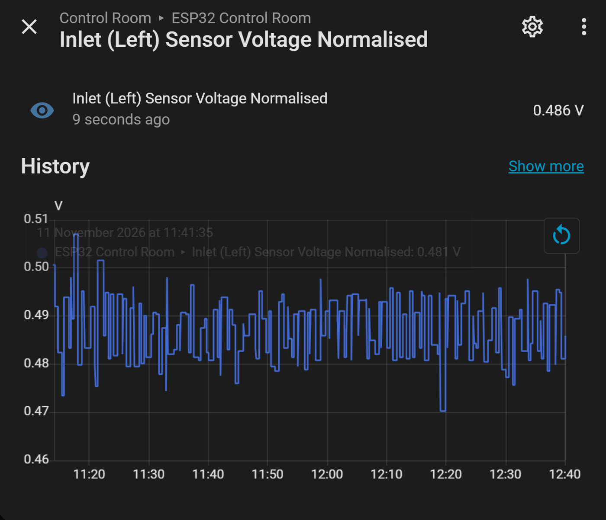
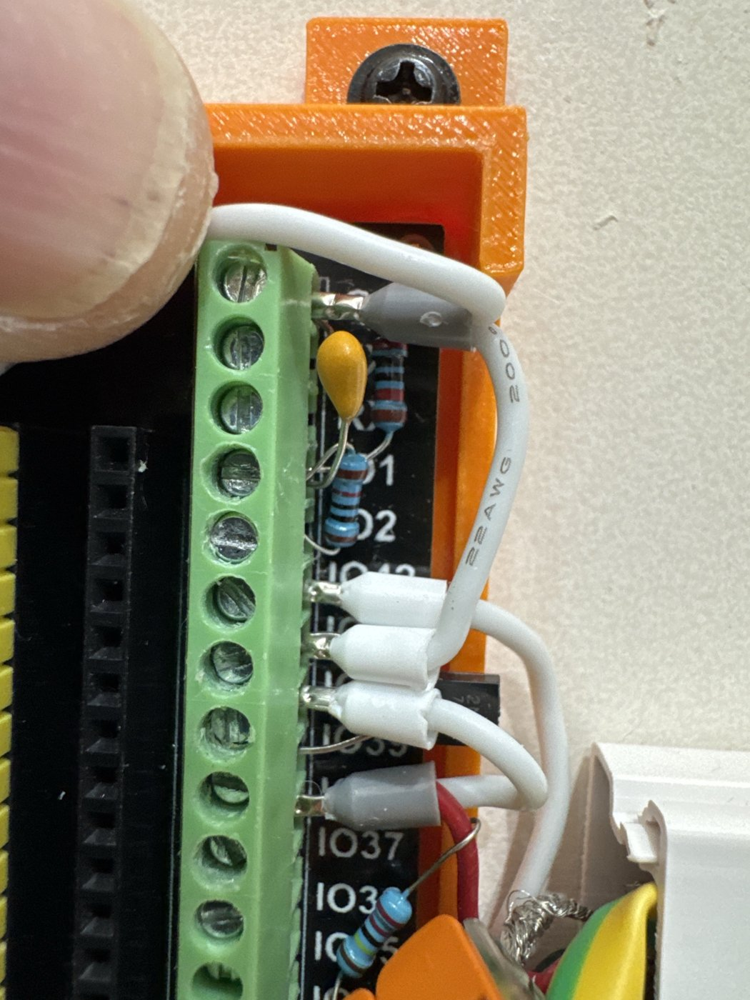
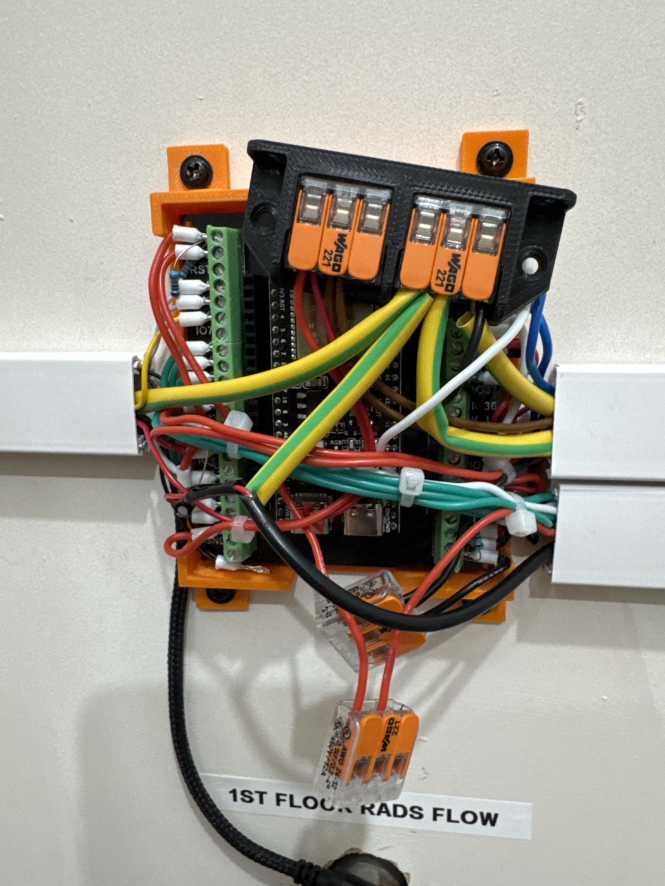
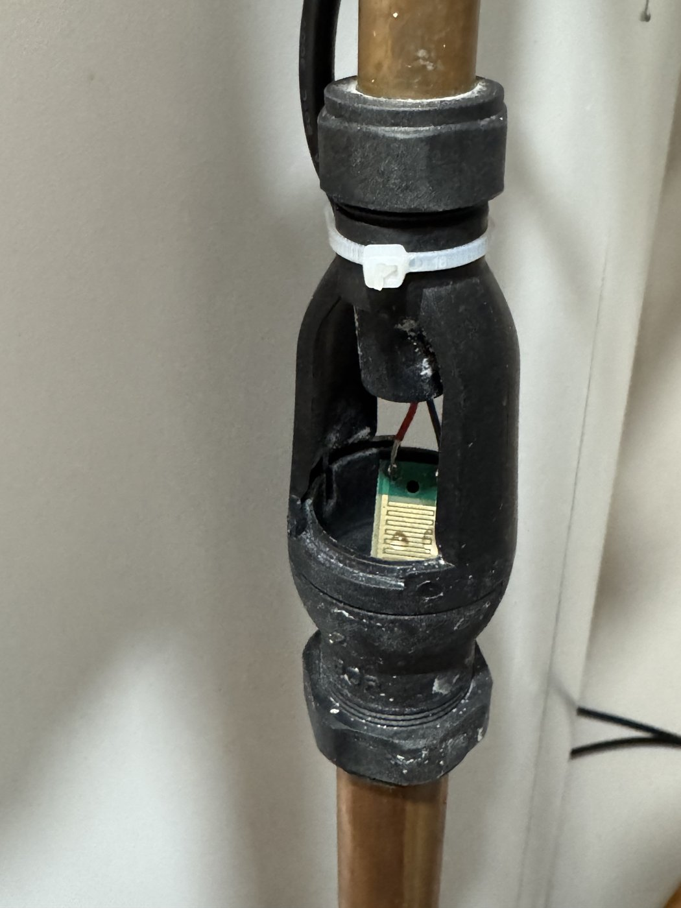

# 13 · Off-Board Wiring: Gauge Boxes, Bus Strip, Posts and the Clamp Strip

[← Back to README](../README.md)

By November the control-room board's screw terminals were carrying resistor and capacitor legs, anchors and twin conductors in the same clamps: hard to work on and easy to disturb. On 10-11 November everything was moved off the board or onto neighbouring-terminal bridges ([doc 12](12-control-room-wiring-schematic.md) has the full drawing). This doc records the decisions and the faults found along the way.

## 1. Pressure sensors: the divider moves to the gauge

Each pressure sensor needs a 10k/20k divider (0.5-4.5 V down to ≈0.33-3.0 V) and a 100 nF filter. They now sit in a small **junction box at each gauge** (four 2-way Wagos), so a plain **signal core** lands on each GPIO.

| Gauge-box Wago | Port 1 | Port 2 |
|---|---|---|
| 5 V | Sensor +5 V | Cable 5 V (brown) |
| Wago 1 | Sensor signal | 10k |
| Wago 2 | Twin: 10k + cable signal (blue) | Twin: 20k + 100 nF |
| GND | Twin: sensor GND + braid | Twin: 20k + 100 nF (in parallel) |

**The trade-off:** the cable now carries the divided, higher-impedance (≈6.7 kΩ) signal, which is slightly more open to pickup than the sensor's own output. Over 1.5-4 m of screened cable, away from mains, with the 100 nF at the box, it's negligible; and the cable can never carry more than 3 V to a pin. The textbook choice (divider at the ADC) was traded for space at the board.

*Left inlet, normalised voltage at room pressure over 1.5 h (mean 0.487 V).*

**Supply decoupling** moves to one shared **470 µF (+100 nF)** across the 5 V and GND buses at the board, serving all three sensors (to fit).

**Zero at room pressure (11 Nov):** 1.5 h means of the normalised voltage: **left 0.487 V, right 0.482 V** (raw swing about ±0.014 V ≈ ±0.035 bar, smoothed by the 1-minute sensors). Span check at working pressure (≈3.5 bar, the PRV setting) to follow, against the expansion vessel's air pressure measured with the cylinder pressurised.

## 2. Bus strip

Two 3-way Wagos in one printed mount: **5 V bus** (ESP 5V + boiler 5 V · L + R brown · 470 µF +) and **GND bus** (ESP GND + boiler GND · L + R braid · link). One twin ferrule per way. A 3-way **GND extension** takes the tundish screens and the clamp and opto GNDs.

## 3. NTCs: resistors bridge neighbouring terminals

- **Boiler flow/return:** NTC wire A and the 3.3k leg share IO4/IO5; the 3.3k's other leg sits in a **3V3** terminal a few positions away.
- **Cylinder outlets:** IO8/IO9 are too far from the 3V3 pins, so **IO10** became a **post** fed from 3V3, with both 3.3k legs on it. Safe for NTCs (a few kΩ); not for high-impedance nodes.
- **B-wires** in twin ferrules to two board GND terminals.
- **A lesson in meter checks:** the first IO8 reading (1.651 V) disagreed with HA; it was exactly the clamp bias (1.65 V) on the **neighbouring** IO3 terminal. Re-measured on IO8: 1.872 V = 45.0 °C against HA's 44.8.
- **Flow and return were swapped** during re-wiring; corrected in the YAML (flow now GPIO4). Check: on firing, flow must rise first and highest.

## 4. Current clamp: standard topology, and a cable fault

The original circuit put the coupling capacitor in **series** (IO3 to an IO13 post), with the clamp from IO13 to GND. Re-done off-board in the **standard** layout to save a Wago:

- **Bias node:** 10k from 3V3 and 10k to GND, with **10 µF from the node to GND** to hold it steady at 1.65 V.
- **The clamp sits between the bias node (white) and IO3 (red)**, so IO3 = 1.65 V + the clamp signal. ESPHome's `ct_clamp` takes the RMS, so the clamp's orientation doesn't matter.
- **Strip:** three 3-way Wagos (3V3 · bias node · GND), reusing the existing opto 3V3 junction.

**Fault found:** after the change, the bias node and IO3 both read **0 V**. Continuity showed the clamp cable's **screen is joined to the white conductor** inside the cable (both go to the jack sleeve). In the old circuit both went to GND, so it didn't matter; in the new one, the screen on GND **shorted the bias node to GND**. Fix: screen off GND and insulated. Bias and IO3 then read **1.65 V**.

## 5. Tundish: what stayed on the board, and why

The MOSFETs and 2.2 MΩ pull-downs stay on the board. Moving them would add joints at the **2 MΩ gate nodes**, where the leakage hunt (doc 05) showed every surface matters, and the 2N7000 legs are too short to straddle Wagos. The resistors were moved **out of the ferrules** to sit **beside** them (so a ferrule no longer carries a hanging component). The two plates were re-terminated swapped (left plate B on IO38, right on IO47), and the YAML sense pins swapped to match. Dry gate readings after the move: IO38 0.30 V, IO47 0.37 V.

## Before and after

| Before (terminals carrying components and anchors) | After (bus strip above, plain wires on the terminals) |
|---|---|
|  |  |

*Tundish plate in its printed holder below the discharge (doc 05).*

