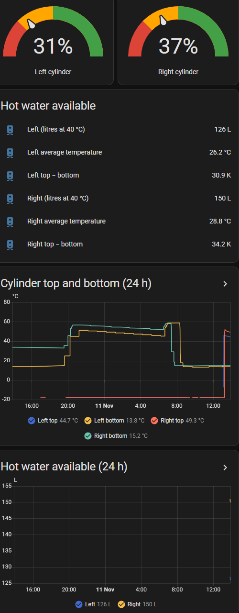
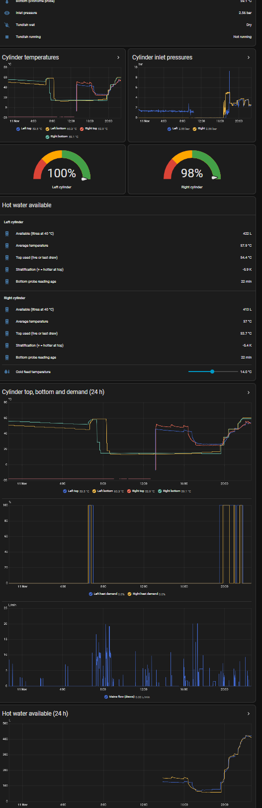

# 14 · Cylinder Stratification and "Hot Water Available"

[← Back to README](../README.md)

With a strap-on NTC on each cylinder's **hot outlet** (top) and the Evohome **CS92** probe in the **lower** pocket (about a quarter of the way up), each Centre Store 250 L cylinder now has a top and a bottom temperature.

## What the two readings show

- **Between reheats, after a draw-off, the gap is large:** e.g. top 44.7 °C, bottom 13.8 °C (31 K) the morning after showers. Hot water floats; cold mains enters at the bottom, right at the CS92's pocket.
- **During a reheat** the coil (near the bottom) heats the lower water, which rises and mixes, and the gap closes.
- **Evohome's probe position** means it calls for heat once enough cold has come in, even with plenty of hot water still at the top: reheats are triggered by **volume used**.
- **Overnight standing loss** visible at the bottom probe: about 5 K over ~10 h.
- **A difference between cylinders** (the left's bottom peaked ~51 °C against ~56 °C on the right on 10 Nov) is still being compared on normal reheats; after paste, both bottom probes reached 59-60 °C on 11 Nov. The left hub was still calling at 21:00 (from a cold refill) when the right had finished, so a slower left reheat remains a lead (zone valve, coil isolation, air).

## Estimating hot water available

Average temperature ≈ 0.25 × bottom (the quarter below the probe) + 0.75 × (bottom + top) / 2 (a linear gradient above it, the expected value when the hot/cold boundary could be anywhere) = **0.4 × top + 0.6 × bottom**.

Litres at 40 °C = 250 × (average − Tcold) / (40 − Tcold). **Tcold is a helper, 14 °C in November** (the bottom probes bottomed out at 13.8-15.2 °C after the refill and the morning showers). 100% = a full cylinder at 58 °C ≈ **423 L at 40 °C**; a shower uses roughly 60-80 L, a bath 120-150 L.

| Example (11 Nov, after showers, v1 at 12 °C) | Left | Right |
|---|---|---|
| Top / bottom | 44.7 / 13.8 °C | 49.3 / 15.2 °C |
| Average | 26.2 °C | 28.9 °C |
| Available | 127 L (31%) | 151 L (37%) |

After the evening reheat the card showed **422 L (100%)** and **413 L (98%)**.

### Version 3 (11 Nov 2026): the top reading, per cylinder

The outlet NTC is strapped to the hot **pipe**. At rest it only warms by conduction and reads **below** the cylinder's top (42-43 °C at the end of a reheat with no draw; a draw lifted it ~5 K). During and just after a draw it reads the true top within about 1-2 K.

- **Each cylinder detects its own draws from its outlet:** when the outlet starts cooling (a derivative below −0.15 K/min for 30 s) after a rise of more than 1 K in the last 10 min, the **highest reading of the last 3 min** is captured as *Top At Last Draw*. That is the peak after a short draw (the strapped probe lags the pipe by 1-2 min) or the end value of a long one, so a shower or bath that runs the cylinder down is **not** over-estimated.
- **The estimate uses the larger of the live outlet and the captured top** (for 6 h). Stratification is reported from the same "top used" value.
- **Versions rejected on the way:** capturing at the end of a whole-house draw (the mains flow meter can't tell which cylinder was drawn from, so back-to-back draws on both sides captured the earlier side late), and a 15-minute peak (over-estimates exactly when a long draw empties a cylinder). Inlet-pressure dips also identify each cylinder's draws, and stay a possible cross-check.
- Verified on both sides on 11 Nov: a kitchen (left) draw captured 56.1 °C, a right draw 55.0 °C.

### Reading the stratification figure

Hot water can't sit stably below cooler water, so a **negative** "top − bottom" is a measurement artefact, not layering: during a reheat the probe sits in the coil's warm plume and the outlet pipe lags; after a reheat it lasts until the first draw. After a draw it is meaningful: about 0 after a full reheat, positive as cold enters at the bottom.

### Limits and next steps

- After a draw-off the true boundary may be anywhere above the probe (±25% or so); best after a reheat and near empty.
- **A fully mixed, lukewarm cylinder** (e.g. all at 36 °C) gives the same % as a half-hot layered one, though none of it is usable at 40 °C. Planned: 0% when the top is below ~42 °C, scaling down from ~45 °C.
- Planned: the utility mains NTC as the cold feed (captured during draws of 30-60 s, as the pipe drifts to room temperature at rest), and checking the 0.4/0.6 weighting after a normal reheat and at the first lukewarm shower.
- The CS92 reports can be ~25 min apart at the gateway's current position (bottom reading age shown on the card).

Package: [config/homeassistant/packages/dhw_hot_water_available.yaml](../config/homeassistant/packages/dhw_hot_water_available.yaml) · card: [dashboards/hot-water-available-card.yaml](../config/homeassistant/dashboards/hot-water-available-card.yaml)

### Is the low probe pocket right? (summary)

Yes, for these cylinders (the only usable pocket; the upper housing has none). After full reheats the tops reached about **57-58 °C (left)** and **56-57 °C (right)** against a 58 °C setpoint, with the probes at 59-60 °C. Pros: early reheat calls keep the cylinder full; reheats end within 1-2 K of setpoint. Cons: the probe sits in the coil plume (reheats can stop a little early); more, shorter reheats; a 1-2 K overshoot; an early stop isn't corrected by mixing (the 5 K differential needs a draw). Legionella: at 58 °C the cylinders never reach 60 °C throughout; deciding between a 60-61 °C setpoint and a weekly HA/RAMSES pasteurising reheat. Full write-up: [Evohome repo, A3](https://github.com/the-control-cabinet/evohome-heating-controls-ramses-integration/blob/main/docs/A3-dhw-cylinders-and-sensor-placement.md).

## CS92 heat-transfer paste

The pockets are larger than the probes, so the gap is air. A thin coat of paste on the probe (not packed into the pocket), pushed fully home and nudged against the wall, makes the probe follow the water more closely and quickly. The effect shows during a reheat, not at steady temperature: compare the rise against an earlier reheat.

## Centre Store settings (from the installation manual)

PRV / operating pressure **3.5 bar** · expansion vessel pre-charge **3.5 bar** (checked with the water side de-pressurised; 24 L for the 250 L) · expansion relief valve **6 bar** · T&P **90 °C / 10 bar**. Intermittent discharge from the expansion valve during reheats = vessel charge below 3.5 bar (the fault behind the tundish drips).
